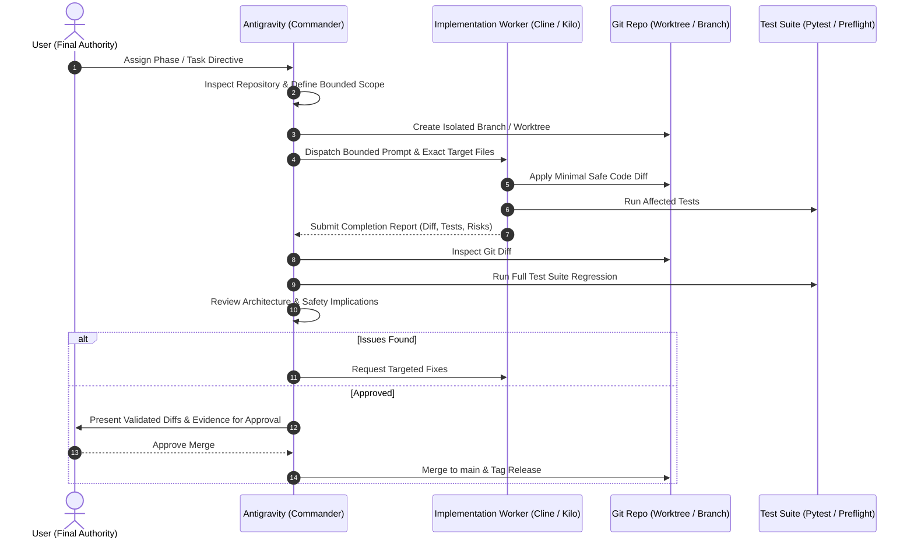

# Antigravity Delegation Protocol

From now on, treat the external implementation agent as a replaceable worker.

You remain **Project Commander, Lead Architect, Reviewer, Integration Lead, and QA Coordinator**.

---

## Delegation Lifecycle

---

## Inviolable Rules
1. **One Writer at a Time**: Never allow two implementation agents to write to the same working tree concurrently.
2. **Prior Inspection**: Before delegation, inspect the repository and define exact target files and scope bounds.
3. **No Cascading Tasks**: Do not start another task until the current task passes review.
4. **No Live Trading Delegation**: Never delegate live trading or safety-critical release actions without explicit user approval.
