# AI Roles & Decision Hierarchy

This specification defines the explicit roles, authorities, prompt guidelines, and limitations for each artificial intelligence agent and automated module in the ecosystem.

---

## 1. System Roles Matrix

```mermaid
flowchart TD
    subgraph Human & Orchestration
        USER[Human User: Final Authority]
        AGY[Antigravity: Project Commander & Architect]
        CODEX[Codex CLI: Implementation Worker]
    end

    subgraph Trading Execution Pipeline
        CR[Quantitative Candidate Generator]
        QWEN[Qwen3: Primary Market Analyst]
        R1[DeepSeek-R1: Adversarial Challenger]
        TG[Deterministic Trade Gate]
        PW[Independent Position Watcher]
    end

    USER -->|Approval & Live Gates| AGY
    AGY -->|Delegates Implementation Tasks| CODEX
    CR -->|Detected Setup| QWEN
    QWEN -->|Thesis & Evidence| R1
    R1 -->|Counter-Analysis & Flaws| TG
    CR -->|Metrics & Math| TG
    TG -->|Authorized TradePlan| PW
```

---

## 2. Detailed Role Definitions

### 1. Antigravity IDE / CLI (Project Commander)
- **Authority**: High (Orchestrator).
- **Scope**: Requirements definition, architectural design, file review, QA test coordination, task delegation, and documentation management.
- **Constraints**: Never writes production code concurrently with Codex CLI. Does not authorize live capital deployment without explicit human consent.

### 2. Codex CLI (Core Implementation Worker)
- **Authority**: Medium (Developer).
- **Scope**: Generates Python and React code, creates unit tests, implements API endpoints and adapters under bounded delegation tasks assigned by Antigravity.
- **Constraints**: Never modifies architecture documents unless explicitly instructed. Operates strictly under the One-Writer Rule.

### 3. Qwen3 (Primary Market Analyst)
- **Authority**: Low (Evidence Proposer).
- **Scope**: Consumes structured numerical feature snapshots (momentum, volume, VWAP, spreads) and generates structured JSON output proposing a qualitative market thesis and rationale.
- **Constraints**: Cannot execute trades or communicate with brokers. Must strictly output JSON matching the `MarketThesisSchema`.

### 4. DeepSeek-R1 (Adversarial Challenger)
- **Authority**: Low (Stress-Testing Challenger).
- **Scope**: Ingests candidate data and Qwen3's thesis. Actively searches for contradictions, hidden risks, false breakouts, and adverse market regimes.
- **Constraints**: Does not vote on trades. Outputs structured critique to highlight vulnerabilities.

### 5. Deterministic Trade Gate & Position Watcher
- **Authority**: Absolute for Execution and Emergency Exits.
- **Scope**: Evaluates quantitative math, friction costs, capital caps, and hard stops. Liquidates endangered trades immediately.
- **Constraints**: Contains zero LLM or probabilistic reasoning components.
