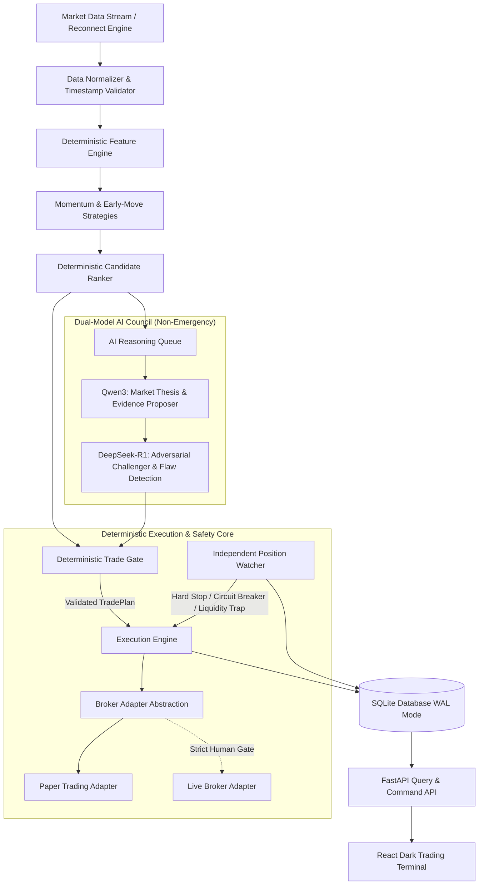

# System Architecture: AI Micro-Trading Agent

## 1. Architectural Overview & Philosophy

The **AI Micro-Trading Agent** is a local-first, low-cost algorithmic trading system with an autonomous execution core governed strictly by deterministic risk and capital gates. It incorporates dual-LLM qualitative reasoning (Qwen3 as thesis generator and DeepSeek-R1 as adversarial challenger) without ever allowing non-deterministic AI models to take part in execution gating or emergency exits.

---

## 2. Locked Boundaries & Pipeline Order

The data and decision pipeline follows a strict, unidirectional path:
1. **Market Data**: Raw WebSocket/REST market ticks or OHLCV feeds.
2. **Normalizer**: Standardizes event schemas, validates monotonic timestamps, attaches source metadata, and tags stale data.
3. **Feature Engine**: Calculates deterministic indicators (momentum, VWAP deviation, volume acceleration, liquidity, spread, volatility) with strict timestamp safety to prevent look-ahead bias.
4. **Strategies**: Generates BUY candidates via two independent deterministic modules:
   - *Momentum Continuation*
   - *Early-Move Detection*
5. **Candidate Ranker**: Ranks candidates deterministically using configurable rules and evidence metrics.
6. **AI Queue & Council**:
   - `Qwen3`: Generates a structured JSON hypothesis, context summary, and invalidation criteria.
   - `DeepSeek-R1`: Stress-tests the hypothesis, searches for contradictory signals, and assesses downside vulnerability.
7. **Deterministic Trade Gate**: Combines the candidate metrics, AI feedback, portfolio risk, transaction costs, and capital thresholds. Synthesizes an immutable `TradePlan` or rejects the setup.
8. **Execution Engine**: Translates approved `TradePlan` into order lifecycle states (`CREATED` → `SUBMITTED` → `ACKNOWLEDGED` → `PARTIALLY_FILLED` → `FILLED`).
9. **Position Watcher**: Operates continuously and independently. Enforces hard stop-loss, trailing stops, stale data exits, liquidity halts, and daily loss circuit breakers.
10. **Journal & Performance**: Records every tick, feature, candidate, AI thesis, decision reason, fill, and metric into SQLite in WAL mode.

---

## 3. Ownership Boundaries & Authority Hierarchy

| Authority Level | Actor | Scope & Responsibilities |
| :--- | :--- | :--- |
| **Final Authority** | **User (Human)** | Architectural mutations, broker credentials, capital allowance increases, and live-trading activation. |
| **Project Commander** | **Antigravity** | Architecture compliance, planning, specifications, workflow orchestration, PR review, QA, and documentation. |
| **Coding Worker** | **Codex CLI** | Code generation, refactoring, unit/integration test implementation across backend, engine, and frontend. |
| **Autonomous Safety** | **Position Watcher** | Real-time position monitoring, hard stops, max drawdown shutdown, circuit breakers. Zero reliance on LLMs. |
| **Evidence Proposer** | **Qwen3 (Local Ollama)** | Qualitative market thesis synthesis based on structured feature snapshots. |
| **Adversarial Reasoner**| **DeepSeek-R1 (Local Ollama)**| Stress-testing thesis, identifying edge weaknesses and counter-arguments. |

---

## 4. The One-Writer Rule & Multi-Agent Collaboration

To prevent state desynchronization and race conditions between autonomous agents:
- **Strict Single Writer**: Antigravity and Codex CLI shall never edit the same files or directories concurrently.
- **Orchestration Loop**:
  1. Antigravity writes bounded technical specs and test criteria.
  2. Codex CLI is invoked to implement the code and run local tests.
  3. Antigravity inspects `git diff`, validates implementation against specs, and approves or requests fixes.
  4. Antigravity updates project documentation (`TASKS.md`, `DECISIONS.md`, checkpoints).
  5. User provides approval at the designated phase gate.

---

## 5. Non-Negotiable Safety Invariants

1. **No LLM in Emergency Exits**: The Position Watcher must trigger hard stops, timeout stops, and circuit breakers deterministically. It must never wait for an LLM response to exit a losing or endangered trade.
2. **Deterministic Precedence**: If an LLM recommends BUY but deterministic risk, spread, liquidity, or capital rules reject it, the trade is rejected without exception.
3. **Paper Before Live**: No real capital will be committed until paper trading passes all statistical validation criteria in Phase 18 and human approval is recorded in Phase 19.
4. **Capital Ceiling**: Initial live testing is strictly capped at ₹100, with an autonomous operating threshold capped at ₹300. Any higher allocation requires explicit human authorization.
5. **No Direct Order Injection**: Neither AI models nor general-purpose API endpoints may directly dispatch market orders without passing through the Deterministic Trade Gate.
