# System Architecture: AI Micro-Trading Agent

## 1. Architectural Overview & Philosophy

The **AI Micro-Trading Agent** is a local-first, low-cost algorithmic trading system with an autonomous execution core governed strictly by deterministic risk and capital gates. It incorporates dual-LLM qualitative reasoning (Qwen3 as thesis generator and DeepSeek-R1 as adversarial challenger) without ever allowing non-deterministic AI models to take part in execution gating or emergency exits.

```mermaid
flowchart TD
    MD[Market Data Stream / Reconnect Engine] --> NORM[Data Normalizer & Timestamp Validator]
    NORM --> FE[Deterministic Feature Engine]
    FE --> STRAT[Momentum & Early-Move Strategies]
    STRAT --> CR[Deterministic Candidate Ranker]
    CR --> AIQ[AI Reasoning Queue (Async / Non-Blocking)]
    
    subgraph "Dual-Model AI Council (Non-Emergency Qualitative Layer)"
        AIQ --> QWEN[Qwen3: Market Thesis & Evidence Proposer]
        QWEN --> R1[DeepSeek-R1: Adversarial Challenger & Flaw Detection]
    end
    
    CR --> TG[Deterministic Trade Gate]
    R1 --> TG
    
    subgraph "Deterministic Execution & Safety Core"
        TG -->|Validated TradePlan| EXEC[Execution Engine]
        EXEC --> BA[Broker Adapter Abstraction]
        BA --> PAPER[Paper Trading Adapter]
        BA -.->|Strict Human Gate| LIVE[Live Broker Adapter]
        
        PW[Independent Position Watcher]
        PW -->|Hard Stop / Circuit Breaker / Liquidity Trap| EXEC
    end
    
    EXEC --> DB[(SQLite Database WAL Mode)]
    PW --> DB
    DB --> API[FastAPI Query & Command API]
    API --> UI[React Dark Trading Terminal]
```

---

## 2. Locked Boundaries & Pipeline Order

The data and decision pipeline follows a strict, unidirectional path:
1. **Market Data**: Ingests raw tick feeds or bar candles (`RawMarketTick`).
2. **Normalizer**: Standardizes event schemas, validates monotonic timestamps, attaches source metadata, and tags stale data (`NormalizedMarketEvent`).
3. **Feature Engine**: Calculates deterministic indicators (momentum, VWAP deviation, volume acceleration, liquidity, spread, volatility) with strict timestamp safety to prevent look-ahead bias (`FeatureSnapshot`).
4. **Strategies**: Generates BUY candidates via two independent deterministic modules:
   - *Momentum Continuation*
   - *Early-Move Detection*
5. **Candidate Ranker**: Ranks candidates deterministically using configurable scoring rules and evidence metrics (`Candidate`).
6. **AI Queue & Council**:
   - `Qwen3`: Generates a structured JSON hypothesis, context summary, and invalidation criteria (`MarketThesis`).
   - `DeepSeek-R1`: Stress-tests the hypothesis, searches for contradictory signals, and assesses downside vulnerability (`ChallengerCritique`).
7. **Deterministic Trade Gate**: Combines candidate metrics, AI feedback, portfolio risk, transaction costs, and capital thresholds. Synthesizes an immutable `TradePlan` or rejects the setup.
8. **Execution Engine**: Translates approved `TradePlan` into order lifecycle states (`CREATED` → `SUBMITTED` → `ACKNOWLEDGED` → `PARTIALLY_FILLED` → `FILLED`).
9. **Position Watcher**: Operates continuously and independently. Enforces hard stop-loss, trailing stops, stale data exits, liquidity halts, and daily loss circuit breakers (`WatcherInterventionEvent`).
10. **Journal & Performance**: Records every tick, feature, candidate, AI thesis, decision reason, fill, and metric into SQLite in WAL mode.

---

## 3. Ownership Boundaries & Authority Hierarchy

| Authority Level | Actor | Scope & Responsibilities |
| :--- | :--- | :--- |
| **Final Authority** | **User (Human)** | Architectural mutations, broker credentials, capital allowance increases, and live-trading activation. |
| **Project Commander** | **Antigravity** | Architecture compliance, planning, specifications, workflow orchestration, PR review, QA, and documentation. |
| **Coding Worker** | **Codex CLI** | Code generation, refactoring, unit/integration test implementation across backend, engine, and frontend. |
| **Autonomous Safety** | **Position Watcher** | Real-time position monitoring, hard stops, max drawdown shutdown, circuit breakers. Zero reliance on LLMs. |
| **Evidence Proposer** | **Qwen3 (Local Ollama)** | Qualitative market thesis synthesis based on structured feature snapshots. |
| **Adversarial Reasoner**| **DeepSeek-R1 (Local Ollama)**| Stress-testing thesis, identifying edge weaknesses and counter-arguments. |

---

## 4. The One-Writer Rule & Multi-Agent Collaboration

To prevent state desynchronization and race conditions between autonomous agents:
- **Strict Single Writer**: Antigravity and Codex CLI shall never edit the same files or directories concurrently.
- **Orchestration Loop**:
  1. Antigravity writes bounded technical specs and test criteria.
  2. Codex CLI is invoked to implement the code and run local tests.
  3. Antigravity inspects `git diff`, validates implementation against specs, and approves or requests fixes.
  4. Antigravity updates project documentation (`TASKS.md`, `DECISIONS.md`, checkpoints).
  5. User provides approval at the designated phase gate.

---

## 5. Non-Negotiable Safety Invariants

1. **No LLM in Emergency Exits**: The Position Watcher must trigger hard stops, timeout stops, and circuit breakers deterministically. It must never wait for an LLM response to exit a losing or endangered trade.
2. **Deterministic Precedence**: If an LLM recommends BUY but deterministic risk, spread, liquidity, or capital rules reject it, the trade is rejected without exception.
3. **Paper Before Live**: No real capital will be committed until paper trading passes all statistical validation criteria in Phase 18 and human approval is recorded in Phase 19.
4. **Capital Ceiling**: Initial live testing is strictly capped at ₹100, with an autonomous operating threshold capped at ₹300. Any higher allocation requires explicit human authorization.
5. **No Direct Order Injection**: Neither AI models nor general-purpose API endpoints may directly dispatch market orders without passing through the Deterministic Trade Gate.

---

## 6. Pipeline Boundary Specifications & Interface Contracts

Every boundary in the pipeline is governed by a typed Pydantic v2 contract located in `app.models.contracts`:

| Hop # | Boundary Transition | Ingest Contract | Output Contract | Verification Gate |
| :--- | :--- | :--- | :--- | :--- |
| **1** | Market Data → Normalizer | Raw network payload | `NormalizedMarketEvent` | Monotonic timestamp, spread $\ge 0$, source metadata check |
| **2** | Normalizer → Feature Engine | `NormalizedMarketEvent` | `FeatureSnapshot` | Zero look-ahead bias, positive liquidity, valid timeframe |
| **3** | Feature Engine → Strategies | `FeatureSnapshot` | Raw Strategy Signals | Signal validation against strategy criteria |
| **4** | Strategies → Candidate Ranker | Strategy Signals | `Candidate` | Configurable scoring thresholds, explainable evidence |
| **5** | Candidate Ranker → AI Queue | `Candidate` | AI Queue Item | Non-blocking async queueing, queue size limit |
| **6** | AI Queue → Qwen3 Analyst | Structured Candidate Data | `MarketThesis` | Strict JSON schema, confidence range `[0.0, 1.0]` |
| **7** | Qwen3 → DeepSeek-R1 Challenger | `Candidate` + `MarketThesis` | `ChallengerCritique` | Structured vulnerability taxonomy, timeout fallback |
| **8** | AI Council → Trade Gate | `Candidate` + AI outputs | `TradePlan` | Indian fee friction check, net-edge hurdle, capital limits |
| **9** | Trade Gate → Execution Engine | `TradePlan` | `OrderRequest` | Idempotency key generation, state machine initialization |
| **10**| Execution Engine → Broker Adapter | `OrderRequest` | `OrderEvent` | Broker ACK, fill reconciliation, error mapping |
| **11**| Continuous Safety | `PositionSnapshot` | `WatcherInterventionEvent` | Real-time tick evaluation, sub-50ms hard-stop trigger |
| **12**| Telemetry & Audit | All Pipeline Events | SQLite WAL Records | ACID durability, replayability |

---

## 7. Latency Measurement Matrix & Timing Budgets

To ensure high performance while preserving local-first hardware efficiency, each boundary operates within a measured latency budget:

| Pipeline Stage | Internal Latency Budget | Criticality | Behavior on Breach |
| :--- | :--- | :--- | :--- |
| **Market Data Normalization** | $< 5\text{ ms}$ | High | Log warning; drop corrupt tick |
| **Feature Engine Computation** | $< 15\text{ ms}$ | High | Tag feature computation delay |
| **Strategy & Candidate Generation** | $< 20\text{ ms}$ | Medium | Skip stale bar evaluation |
| **Deterministic Trade Gate Decision**| $< 25\text{ ms}$ | High | Reject candidate if timing invalid |
| **Position Watcher Stop Evaluation** | $< 50\text{ ms}$ | **CRITICAL** | Autonomous emergency market exit order |
| **Order Dispatch (Internal to Adapter)**| $< 30\text{ ms}$ | High | Abort dispatch if client timeout |
| **Qwen3 Analyst Inference (Local LLM)** | $< 3500\text{ ms}$ | Low (Non-Blocking) | Graceful timeout; mark `AI_SKIPPED` |
| **DeepSeek-R1 Challenger (Local LLM)** | $< 4000\text{ ms}$ | Low (Non-Blocking) | Graceful timeout; continue deterministic |
| **SQLite WAL Write** | $< 10\text{ ms}$ | Medium | Retry with exponential backoff (busy timeout 5s) |

---

## 8. Failure Modes & Fail-Safe Defaults

```mermaid
stateDiagram-v2
    state "Normal Operation" as Norm
    state "Stale Data / Feed Drop" as Stale
    state "Model Outage (Ollama Offline)" as ModelOff
    state "Broker Disconnect" as BrokerOff
    state "Emergency Liquidation" as Emergency

    Norm --> Stale : Ticks stalled > 15s
    Stale --> Norm : Feed resumed
    Stale --> Emergency : Position exposed > 30s stale

    Norm --> ModelOff : LLM timeout / crash
    ModelOff --> Norm : Continue deterministic only

    Norm --> BrokerOff : Broker REST/WS down
    BrokerOff --> Emergency : Broker reconnect fails; halt new trades

    Norm --> Emergency : Hard stop breached OR circuit breaker
```



---

## 9. Dependency-Ordered Implementation Plan

Following Phase 01 approval, implementation proceeds strictly according to this dependency sequence:

```
Phase 02: UI/UX Design System Specification
    ↓
Phase 03: Market Data & Normalization (Codex Implementation)
    ↓
Phase 04: Deterministic Feature Engine (Codex Implementation)
    ↓
Phase 05: BUY Engine: Momentum + Early-Move (Codex Implementation)
    ↓
Phase 06: SELL Engine + Independent Position Watcher (Codex Implementation - CRITICAL SAFETY)
    ↓
Phase 07: Capital, Risk & Cost Engine (Indian Market Fees)
    ↓
Phase 08: Execution Engine + Broker Abstraction (PaperAdapter)
    ↓
Phase 09: Event-Driven Backtesting & Simulation Loop
    ↓
Phase 10: Qwen3 Analyst Integration (Local Ollama / Prompt Templates)
    ↓
Phase 11: DeepSeek-R1 Challenger Layer (Adversarial Critique)
    ↓
Phase 12: Deterministic Trade Gate + AI Council Integration
    ↓
Phase 13: Database WAL Persistence, Trade Journal & Audit
    ↓
Phase 14: FastAPI Backend & API Contracts
    ↓
Phase 15: React Dark Trading Terminal
    ↓
Phase 16: Integration Testing & Failure Injection Suite
    ↓
Phase 17: Performance & Latency Optimization
    ↓
Phase 18: Paper Trading Validation Period
    ↓
Phase 19: Controlled ₹100 Live Readiness Approval Gate (HUMAN GATE)
    ↓
Phase 20: ₹100 Controlled Live Experiment
    ↓
Phase 21: ₹300 Autonomous Mode
    ↓
Phase 22: Learning & Continuous Improvement
    ↓
Phase 23: Production Hardening & Runbooks
    ↓
Phase 24: Project Completion Gate
```
