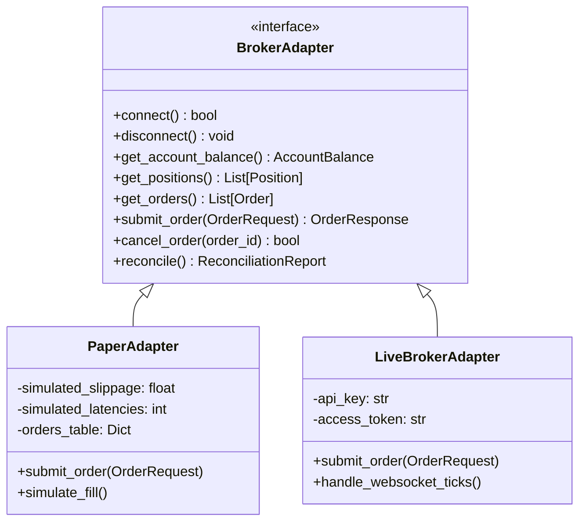
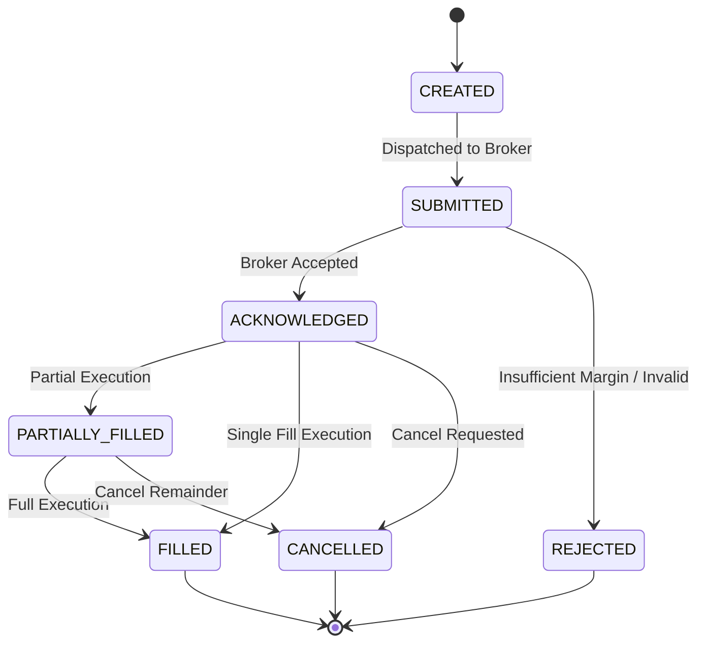

# Broker Adapter Specification & Abstraction

## 1. Architectural Abstraction

The trading core remains completely decoupled from specific broker SDKs or proprietary APIs. All communication passes through the abstract `BrokerAdapter` interface.

---

## 2. Order Lifecycle State Machine

Orders must transition strictly through the following sequence:

---

## 3. Invariants & Implementation Requirements

1. **Idempotency & Duplicate Order Prevention**:
   - Every order submission requires a client-generated UUID `client_order_id`.
   - The adapter checks local history; duplicate attempts within a 60-second window are rejected immediately.
2. **Reconciliation Loop**:
   - Every 60 seconds (or after connection recovery), the adapter queries broker positions and compares them against the local database.
   - Any mismatch generates a `CRITICAL` risk event and halts new entries.
3. **PaperAdapter Fidelity**:
   - `PaperAdapter` must accurately simulate order submission latency (50–150ms), partial fills, and realistic slippage based on bid-ask spreads.
