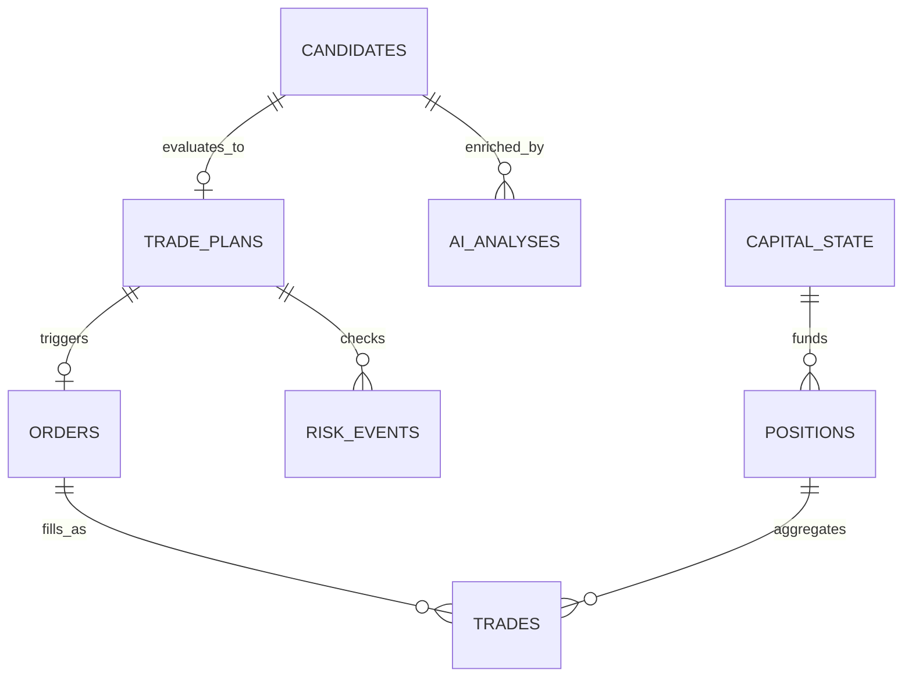

# Database Schema & Data Models

The persistence layer uses **SQLite 3** configured with Write-Ahead Logging (`WAL`), strict foreign keys, and normalized tables to guarantee durability and audit reproducibility.

---

## 1. Engine Configuration & PRAGMA Settings

```sql
PRAGMA journal_mode = WAL;
PRAGMA synchronous = NORMAL;
PRAGMA foreign_keys = ON;
PRAGMA busy_timeout = 5000;
```

---

## 2. Entity-Relationship Model



---

## 3. Core Tables & DDL Definitions

### `capital_state`
Tracks account equity, deployed capital, cash reserves, and daily drawdown metrics.
```sql
CREATE TABLE IF NOT EXISTS capital_state (
    id INTEGER PRIMARY KEY AUTOINCREMENT,
    timestamp TEXT NOT NULL,
    total_capital REAL NOT NULL,
    available_capital REAL NOT NULL,
    deployed_capital REAL NOT NULL,
    buying_power REAL NOT NULL,
    realized_pnl REAL NOT NULL,
    unrealized_pnl REAL NOT NULL,
    daily_drawdown REAL NOT NULL,
    high_water_mark REAL NOT NULL,
    currency TEXT NOT NULL DEFAULT 'INR'
);
```

### `positions`
Maintains live and closed portfolio positions.
```sql
CREATE TABLE IF NOT EXISTS positions (
    id TEXT PRIMARY KEY,
    symbol TEXT NOT NULL,
    side TEXT NOT NULL CHECK(side IN ('LONG', 'SHORT')),
    quantity INTEGER NOT NULL,
    entry_price REAL NOT NULL,
    current_price REAL NOT NULL,
    hard_stop_price REAL NOT NULL,
    take_profit_price REAL,
    trailing_stop_price REAL,
    realized_pnl REAL DEFAULT 0.0,
    status TEXT NOT NULL CHECK(status IN ('OPEN', 'CLOSING', 'CLOSED')),
    opened_at TEXT NOT NULL,
    closed_at TEXT,
    exit_reason TEXT
);
```

### `orders`
Logs every order transmitted to the paper or live broker.
```sql
CREATE TABLE IF NOT EXISTS orders (
    id TEXT PRIMARY KEY,
    client_order_id TEXT UNIQUE NOT NULL,
    position_id TEXT,
    symbol TEXT NOT NULL,
    side TEXT NOT NULL CHECK(side IN ('BUY', 'SELL')),
    order_type TEXT NOT NULL CHECK(order_type IN ('MARKET', 'LIMIT', 'STOP')),
    quantity INTEGER NOT NULL,
    price REAL,
    filled_quantity INTEGER DEFAULT 0,
    average_fill_price REAL DEFAULT 0.0,
    status TEXT NOT NULL CHECK(status IN ('CREATED', 'SUBMITTED', 'ACKNOWLEDGED', 'PARTIALLY_FILLED', 'FILLED', 'CANCELLED', 'REJECTED')),
    created_at TEXT NOT NULL,
    updated_at TEXT NOT NULL,
    FOREIGN KEY(position_id) REFERENCES positions(id)
);
```

### `trades`
Records execution executions (fills).
```sql
CREATE TABLE IF NOT EXISTS trades (
    id TEXT PRIMARY KEY,
    order_id TEXT NOT NULL,
    symbol TEXT NOT NULL,
    side TEXT NOT NULL,
    quantity INTEGER NOT NULL,
    price REAL NOT NULL,
    fee_brokerage REAL NOT NULL,
    fee_stt REAL NOT NULL,
    fee_exchange REAL NOT NULL,
    fee_sebi REAL NOT NULL,
    fee_stamp_duty REAL NOT NULL,
    fee_gst REAL NOT NULL,
    slippage REAL NOT NULL,
    total_friction REAL NOT NULL,
    executed_at TEXT NOT NULL,
    FOREIGN KEY(order_id) REFERENCES orders(id)
);
```

### `candidates` & `features`
Preserves setup discoveries and quantitative indicators.
```sql
CREATE TABLE IF NOT EXISTS candidates (
    id TEXT PRIMARY KEY,
    timestamp TEXT NOT NULL,
    symbol TEXT NOT NULL,
    strategy_name TEXT NOT NULL,
    score REAL NOT NULL,
    evidence JSON NOT NULL,
    status TEXT NOT NULL CHECK(status IN ('DETECTED', 'REJECTED', 'PROMOTED'))
);

CREATE TABLE IF NOT EXISTS features (
    id INTEGER PRIMARY KEY AUTOINCREMENT,
    symbol TEXT NOT NULL,
    timestamp TEXT NOT NULL,
    timeframe TEXT NOT NULL,
    vwap REAL NOT NULL,
    relative_volume REAL NOT NULL,
    volume_accel REAL NOT NULL,
    price_accel REAL NOT NULL,
    volatility REAL NOT NULL,
    spread REAL NOT NULL,
    liquidity_score REAL NOT NULL
);
```

### `ai_analyses`
Stores Qwen3 hypotheses and DeepSeek-R1 adversarial evaluations.
```sql
CREATE TABLE IF NOT EXISTS ai_analyses (
    id TEXT PRIMARY KEY,
    candidate_id TEXT NOT NULL,
    model_name TEXT NOT NULL,
    role TEXT NOT NULL CHECK(role IN ('ANALYST', 'CHALLENGER')),
    thesis TEXT NOT NULL,
    evidence JSON NOT NULL,
    invalidation_conditions JSON NOT NULL,
    risks JSON NOT NULL,
    suggested_action TEXT NOT NULL,
    latency_ms INTEGER NOT NULL,
    prompt_version TEXT NOT NULL,
    created_at TEXT NOT NULL,
    FOREIGN KEY(candidate_id) REFERENCES candidates(id)
);
```

### `trade_plans`
Immutable output of the Deterministic Trade Gate.
```sql
CREATE TABLE IF NOT EXISTS trade_plans (
    id TEXT PRIMARY KEY,
    candidate_id TEXT NOT NULL,
    symbol TEXT NOT NULL,
    side TEXT NOT NULL,
    quantity INTEGER NOT NULL,
    entry_price_target REAL NOT NULL,
    hard_stop REAL NOT NULL,
    expected_edge REAL NOT NULL,
    estimated_costs REAL NOT NULL,
    decision_reason TEXT NOT NULL,
    approval_mode TEXT NOT NULL CHECK(approval_mode IN ('AUTONOMOUS', 'MANUAL_PENDING', 'MANUAL_APPROVED', 'REJECTED')),
    created_at TEXT NOT NULL,
    FOREIGN KEY(candidate_id) REFERENCES candidates(id)
);
```

### `risk_events`, `model_calls`, `execution_metrics`, `system_events`
Audit logs capturing system health, latency, and emergency interventions.
```sql
CREATE TABLE IF NOT EXISTS risk_events (
    id INTEGER PRIMARY KEY AUTOINCREMENT,
    timestamp TEXT NOT NULL,
    event_type TEXT NOT NULL,
    severity TEXT NOT NULL CHECK(severity IN ('INFO', 'WARNING', 'CRITICAL')),
    details JSON NOT NULL
);

CREATE TABLE IF NOT EXISTS system_events (
    id INTEGER PRIMARY KEY AUTOINCREMENT,
    timestamp TEXT NOT NULL,
    source TEXT NOT NULL,
    level TEXT NOT NULL,
    message TEXT NOT NULL
);
```
