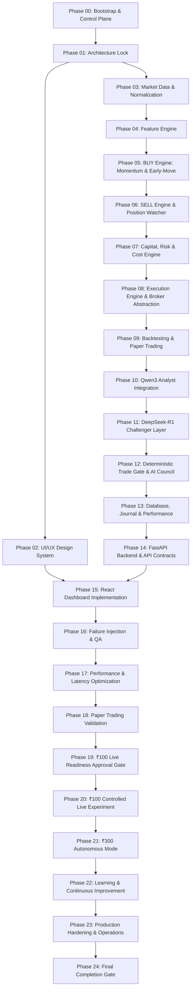

# Development Plan & Phase Milestones

This plan outlines the sequential progression of the AI Micro-Trading Agent through all 25 phases, enforcing strict phase gates, testing criteria, and checkpoint sign-offs.

## Phase Dependency Roadmap

---

## Detailed Phase Breakdown

### Foundation & Specifications
- **Phase 00**: Project Bootstrap & Control Plane (Control files, env check, Codex probe, repo scaffolding).
- **Phase 01**: Architecture Lock & Technical Design (Data contracts, event schemas, pipeline lock).
- **Phase 02**: UI/UX Design System (Terminal wireframes, design tokens, deterministic vs AI visual distinction).

### Core Trading Engine (Deterministic)
- **Phase 03**: Market Data & Normalization (Provider adapter, monotonic timestamping, reconnect loop).
- **Phase 04**: Feature Engine (Momentum, VWAP, relative volume, volatility, regime indicators).
- **Phase 05**: BUY Engine (Momentum continuation & early-move strategies, candidate ranking).
- **Phase 06**: SELL Engine & Position Watcher (Hard stops, catastrophic liquidity traps, trailing stops).
- **Phase 07**: Capital, Risk & Cost Engine (Transaction-cost calculator, position sizing, circuit breakers).
- **Phase 08**: Execution Engine & Broker Abstraction (Order state machine, idempotent submission).
- **Phase 09**: Backtesting & Paper Trading (Event-driven simulator, zero look-ahead, walk-forward).

### Intelligence & Synthesis
- **Phase 10**: Qwen3 Integration (Structured hypothesis generation, invalidation schemas).
- **Phase 11**: DeepSeek-R1 Challenger Layer (Adversarial thesis critique, stress testing).
- **Phase 12**: Deterministic Trade Gate + AI Council (Final TradePlan synthesis, strict pre-execution checks).

### Application Layer
- **Phase 13**: Database, Journal & Performance (SQLite WAL, audit trails, event replay).
- **Phase 14**: FastAPI Backend & API Contracts (Query endpoints, guarded mutation APIs, OpenAPI).
- **Phase 15**: React Dashboard Implementation (Dark-first trading UI, state badges, chart panels).

### Validation & Live Progression
- **Phase 16**: Integration, Failure Injection & QA (Network drops, stale feeds, LLM outages, crash recovery).
- **Phase 17**: Performance & Latency Optimization (Bottleneck profiling, memory and query tuning).
- **Phase 18**: Paper Trading Validation (Full cycle execution without real funds, statistical proof).
- **Phase 19**: Controlled ₹100 Live Readiness (Human approval gate, credential audit, kill switch).
- **Phase 20**: ₹100 Controlled Live Experiment (Real micro-capital deployment, strict metrics monitoring).
- **Phase 21**: ₹300 Autonomous Mode (Extended capital threshold under autonomous risk boundaries).
- **Phase 22**: Learning & Continuous Improvement (Post-trade analytics, versioned strategy tuning).
- **Phase 23**: Final Production Hardening (Runbooks, incident response protocols, disaster recovery).
- **Phase 24**: Completion Gate (Comprehensive repository verification and project sign-off).
