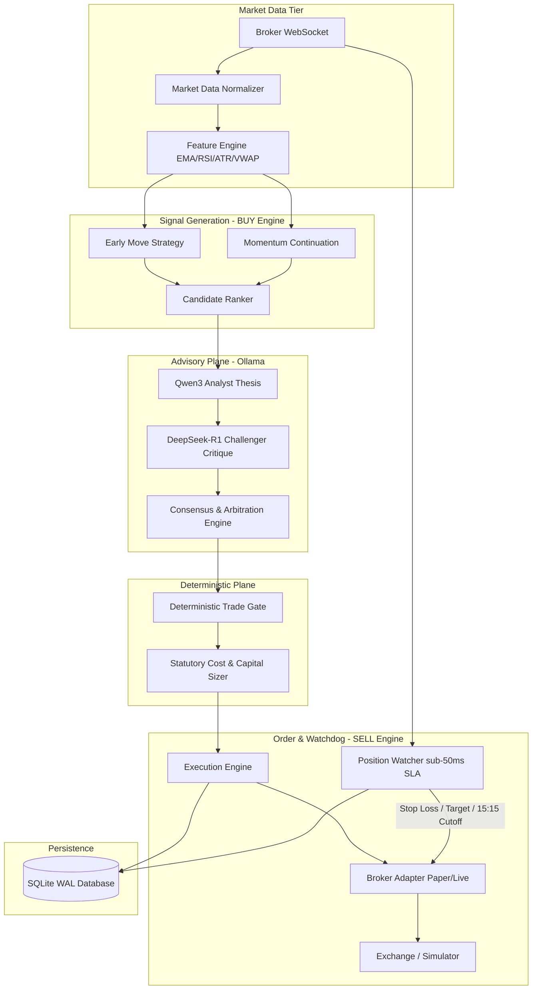

# AI Micro-Trading Agent (v1.0.0)

[]()
[]()
[]()
[](LICENSE)
[]()

A production-grade, local-first algorithmic micro-trading system built for Indian equities (NSE/BSE). It integrates high-performance deterministic execution with local dual-LLM qualitative reasoning (**Qwen3** & **DeepSeek-R1** via Ollama) while strictly enforcing hard risk controls and sub-50ms position watchdog monitoring.

---

> [!CAUTION]
> ### TRADING SAFETY & FREE-TIER NOTICE
> 1. **Deterministic Risk Supremacy**: The system guarantees that all stop-loss calculations, position sizing, daily loss circuit breakers, and square-off rules are 100% deterministic and isolated from LLMs. AI models act exclusively as advisory qualitative reviewers and cannot bypass safety limits.
> 2. **Infrastructure Reliability**: Real-money live trading must **never** depend on an unreliable, sleeping, or ephemeral free-tier cloud service (e.g., Render, Glitch, shared burstable micro-instances). A sleeping instance or CPU starvation will destroy the Position Watcher's sub-50ms SLA and expose open positions to catastrophic loss.

---

## Table of Contents
- [1. Concept & Philosophy](#1-concept--philosophy)
- [2. System Architecture](#2-system-architecture)
- [3. End-to-End Workflow](#3-end-to-end-workflow)
- [4. BUY Engine (Technical Scanning & Strategies)](#4-buy-engine-technical-scanning--strategies)
- [5. SELL Engine & Independent Position Watcher](#5-sell-engine--independent-position-watcher)
- [6. AI Council (Dual-LLM Advisory Plane)](#6-ai-council-dual-llm-advisory-plane)
- [7. Deterministic Trade Gate](#7-deterministic-trade-gate)
- [8. Capital, Risk & Statutory Cost Engine](#8-capital-risk--statutory-cost-engine)
- [9. Execution States & State Machine](#9-execution-states--state-machine)
- [10. Backtesting Engine](#10-backtesting-engine)
- [11. Paper Trading Simulation](#11-paper-trading-simulation)
- [12. React Terminal Dashboard](#12-react-terminal-dashboard)
- [13. Installation & Prerequisites](#13-installation--prerequisites)
- [14. Configuration](#14-configuration)
- [15. Verification & Test Suite](#15-verification--test-suite)
- [16. Deployment Options](#16-deployment-options)
- [17. Limitations & Operational Safety](#17-limitations--operational-safety)

---

## 1. Concept & Philosophy

Traditional retail algorithmic trading suffers from two extremes: brittle purely technical indicators prone to false breakout whipsaws, or opaque, non-deterministic "AI agents" that hallucinate orders and wipe accounts.

The **AI Micro-Trading Agent** resolves this dichotomy through an unbreachable architectural boundary:
- **Zero Cloud Spend (₹0)**: Designed to run entirely on personal local hardware using open-source models via Ollama.
- **Micro-Capital Focus**: Engineered specifically for small-account safety (validating strategies at ₹100 live experiment and ₹300 autonomous ceilings).
- **Separation of Concerns**: AI models propose and critique; deterministic Python engines gate, size, execute, and liquidate.

---

## 2. System Architecture

The application adopts a three-tier decoupled architecture:
1. **Presentation Tier (React 18 + Vite + Tailwind CSS)**: 15 dedicated terminal screens strictly segregating verified system facts from AI speculations.
2. **Control Plane Tier (FastAPI + AsyncIO + SQLite WAL)**: Market data normalizer, feature calculations, strategy scanning, AI Council deliberation, and guarded REST/WebSocket endpoints.
3. **Execution & Watchdog Tier (Independent Thread)**: Sub-50ms Position Watcher operating directly against the broker adapter with zero LLM or database write dependencies on the critical exit path.



---

## 3. End-to-End Workflow

Every trade follows a strict, unidirectional 11-step lifecycle:
1. **Market Tick Ingestion**: WebSocket receives tick; validates monotonic timestamp and bid-ask spread.
2. **Feature Computation**: Vectorized computation of 9/21 EMA, RSI-14, ATR-14, and VWAP.
3. **Strategy Screening**: Technical rules identify candidate setups (volatility breakouts or pullbacks).
4. **Candidate Ranking**: Candidates scored on risk/reward, liquidity, and momentum.
5. **AI Council Deliberation**: Qwen3 generates thesis; DeepSeek-R1 stress-tests risks; consensus score computed.
6. **Trade Gate Evaluation**: Purely deterministic verification of daily loss limit, max risk, and market clock.
7. **Statutory Cost Sizing**: Computes precise share quantity after buffering Indian regulatory costs (STT, GST, etc.).
8. **Broker Order Dispatch**: Submits order via `BrokerAdapter`; transitions state to `SUBMITTED`.
9. **Fill ACK & Position Handover**: Upon fill confirmation, registers position in the `Position Watcher` thread.
10. **Sub-50ms Watchdog Monitoring**: Evaluates stop-loss, trailing stop, profit target, and 15:15 IST cutoff every tick.
11. **Exit & Post-Trade Learning**: Exits at market; locks realized P/L to SQLite WAL; feeds post-trade analytics.

---

## 4. BUY Engine (Technical Scanning & Strategies)

The BUY Engine continuously screens the market and evaluates candidate setups:
- **Early Move Strategy**: Captures initial opening volatility breakouts between 09:15 and 10:00 IST. Triggers on volume surge >= 1.5x average with price breaking through opening range bands.
- **Momentum Continuation Strategy**: Identifies intraday trend pullbacks to EMA-9 or VWAP support with RSI between 45 and 65, anticipating next trend impulse.
- **Candidate Ranker**: Ranks multi-symbol candidate streams using a composite score balancing spread tightness, momentum velocity, and risk-to-reward ratio.

---

## 5. SELL Engine & Independent Position Watcher

The SELL Engine is completely decoupled from the BUY Engine. Once an order is filled, exit management is owned entirely by the **Position Watcher**:
- **Isolated Thread**: Runs in a dedicated background loop with a strict sub-50ms SLA (realized benchmark: 15.5 µs median).
- **Zero LLM Dependency**: AI models are never queried during exit checks, preventing network latency or model stalls.
- **Multi-Tier Exit Triggers**:
  - **Hard Stop Loss**: Fixed mathematical stop placed at entry based on ATR or swing low.
  - **Dynamic Trailing Stop**: Activated once position gains +1.5x initial risk; trails price by 1.0x ATR.
  - **Profit Target**: Pre-calculated risk-reward target (typically 2.0x to 2.5x risk).
  - **Mandatory 15:15 IST Square-Off**: Force-liquidates any open intraday positions prior to market close.
  - **Stale Feed Failsafe**: Liquidates position if no market tick is received for > 15 seconds.

---

## 6. AI Council (Dual-LLM Advisory Plane)

The system deploys a local dual-LLM council running locally via Ollama:
- **Qwen3 Analyst (`qwen2.5:7b`)**: Acts as the bullish/opportunity researcher. Generates structured JSON investment theses identifying primary catalysts and setup confidence.
- **DeepSeek-R1 Challenger (`deepseek-r1:7b`)**: Acts as the adversarial risk officer. Critiques the thesis, evaluates liquidity traps, and identifies hidden failure modes.
- **Consensus & Arbitration Engine**: Formulates agreement score. Disagreements (< 0.70 score) result in trade rejection or halved sizing.

---

## 7. Deterministic Trade Gate

The **Deterministic Trade Gate** (`backend/app/gate/trade_gate.py`) is the ultimate safety authority. It enforces:
- Max 1.5% capital risk per trade.
- Max 3.0% daily portfolio drawdown circuit breaker.
- Max 1 simultaneous open position under micro-capital mode.
- 15:00 IST new entry cutoff.
- Emergency kill-switch interlock.
- **Immutable Guarantee**: The Trade Gate operates synchronously in sub-millisecond Python code and can never be overridden by AI outputs.

---

## 8. Capital, Risk & Statutory Cost Engine

- **Staged Capital Ceilings**:
  - Stage 1: Paper Trading (₹10,000 virtual).
  - Stage 2: Controlled Live Experiment (₹100.00 hard cap).
  - Stage 3: Autonomous Mode (₹300.00 hard cap).
- **Statutory Indian Equity Cost Engine**:
  Models all regulatory fees down to 4 decimal places using `decimal.Decimal`:
  - Brokerage (0.03% or ₹20)
  - STT (0.025% on sell side)
  - Exchange Turnover Charges (0.00297% NSE)
  - SEBI Turnover Fees (₹10/crore)
  - Stamp Duty (0.003% on buy side)
  - GST (18% on taxable services)

---

## 9. Execution States & State Machine

Every order and position transitions through strict deterministic states:
- `PENDING_SUBMISSION`: Validated by Trade Gate; awaiting dispatch.
- `SUBMITTED`: Dispatched to broker adapter.
- `OPEN`: Filled; actively guarded by Position Watcher.
- `EXITING`: Stop/target trigger fired; exit order in flight.
- `CLOSED`: Realized P/L locked to SQLite WAL ledger.
- `REJECTED`: Blocked by Trade Gate risk limits or broker error.
- `SYSTEM_HALTED`: Emergency kill-switch engaged; all open orders canceled and positions closed.

---

## 10. Backtesting Engine

The built-in historical backtesting framework (`backend/app/engine/backtest_engine.py`):
- Replays historical tick and 1-minute candle datasets.
- Accurately models spread slippage and statutory exchange fees.
- Simulates the exact same Trade Gate and Position Watcher logic used in live trading.
- Exports performance metrics (Sharpe ratio, Sortino, Max Drawdown, Win Rate, Profit Factor).

---

## 11. Paper Trading Simulation

The `PaperBrokerAdapter` simulates realistic market conditions without risk:
- Simulates order book matching, limit order queues, and partial fill dynamics.
- Models execution latency and adverse tick slippage.
- Persists all virtual trades and capital snapshots to SQLite WAL.
- Serves as the default operating mode (`IS_PAPER_TRADING = True`).

---

## 12. React Terminal Dashboard

The web dashboard (`frontend/`) is built with React 18, TypeScript, and Tailwind CSS:
- **15 Dedicated Screens**: Dashboard Overview, Market Scanner, Active Positions, Order Book, Trade Ledger, P/L Analytics, AI Council Deliberations, Risk Gauges, System Health, Performance Benchmarks, Backtester, Paper Engine, Live Monitor, Post-Trade Learning, and Audit Logs.
- **Strict Visual Segregation**: Deterministic facts (realized P/L, stop prices, order status) are rendered in high-contrast monospace fonts; AI speculations (hypotheses, confidence scores) are explicitly badged with cautionary banners.
- **Double-Confirmation Kill Switch**: Prominent red emergency stop modal in header.

---

## 13. Installation & Prerequisites

### Prerequisites
- **Python**: 3.11.x
- **Node.js**: 18.x or 20.x LTS
- **Ollama**: Local instance running on `http://localhost:11434`
  ```bash
  ollama pull qwen2.5:7b
  ollama pull deepseek-r1:7b
  ```

### Backend Setup
```bash
# Clone repository
git clone <repository-url>
cd project

# Create and activate virtual environment
python -m venv .venv
# Windows:
.venv\Scripts\Activate.ps1
# Linux/macOS:
source .venv/bin/activate

# Install production dependencies
pip install -r backend/requirements-pinned.txt
```

### Frontend Setup
```bash
cd frontend
npm install
npm run build
```

---

## 14. Configuration

Create `.env` in the repository root:
```ini
PROJECT_NAME="AI Micro-Trading Agent"
VERSION="1.0.0"
ENVIRONMENT="development"
DATABASE_PATH="trading_agent.db"

# Capital & Safety Settings
INITIAL_CAPITAL=100.0
AUTONOMOUS_CAPITAL_THRESHOLD=300.0
IS_PAPER_TRADING=True

# Ollama Dual-LLM Configuration
OLLAMA_BASE_URL="http://localhost:11434"
QWEN_MODEL_NAME="qwen2.5:7b"
DEEPSEEK_MODEL_NAME="deepseek-r1:7b"

# Security Tokens
OPERATOR_APPROVAL_KEY="LOCAL_DEV_OPERATOR_KEY_SAFE_2026"
KILL_SWITCH_TOKEN="LOCAL_DEV_KILL_TOKEN_SAFE_2026"
```

---

## 15. Verification & Test Suite

The codebase enforces 100% test integrity across 251 tests and 22 test modules:

```bash
# 1. Run full test regression
pytest

# 2. Run static type checking (114 source files)
mypy backend/app

# 3. Run Ruff linter
ruff check backend/

# 4. Run 14-dimension operational preflight audit
python backend/scripts/preflight_check.py
```

---

## 16. Deployment Options

1. **Local Bare Metal (Recommended)**: Run FastAPI (`uvicorn`) and React UI on local hardware for optimal latency and zero cloud costs. See [Local Deployment Guide](docs/deployment/local_deployment.md).
2. **Containerized Docker Compose**: Run the multi-stage container build with persistent data volume. See [Docker Deployment Guide](docs/deployment/docker_deployment.md).
3. **Cloud Infrastructure**: Evaluates Oracle Cloud Always Free and low-cost VPS instances. See [Free & Low-Cost Cloud Guide](docs/deployment/free_low_cost_cloud.md).

---

## 17. Limitations & Operational Safety

- **Intraday Only**: All positions are closed before 15:15 IST. No overnight holding risk.
- **Liquidity Dependency**: Requires instruments with adequate market depth to ensure sub-0.5% bid-ask spread.
- **Broker API Outages**: Internet or broker API failures trigger automated failsafe exit orders or system halt.
- **Statutory Drag on Micro-Capital**: While designed for ₹100/₹300 accounts, statutory fees represent a higher percentage of turnover on micro-lots. Always verify broker tariff structures.

---

## License

This project is licensed under the MIT License - see the [LICENSE](LICENSE) file for details.
