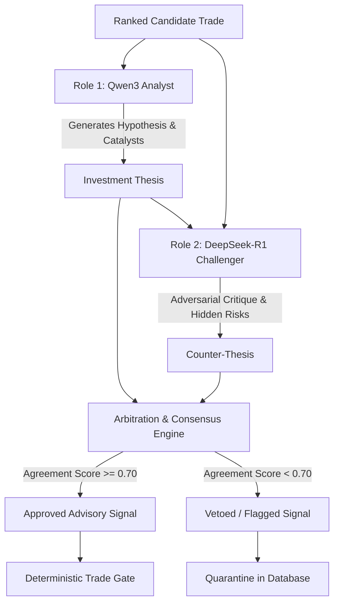

# AI Council Architecture & Dual-LLM Deliberation

The **AI Council** is the qualitative deliberative core of the AI Micro-Trading Agent. It pairs two distinct open-source large language models running locally via Ollama to evaluate trade setups before order generation.

---

## 1. Dual-Model Architecture

---

## 2. Model Roles & Specializations

### Role 1: Qwen3 Analyst (Hypothesis Generator)
- **Model**: `qwen2.5:7b` (or Qwen3 equivalent).
- **Function**: Scrutinizes technical indicators, market regime, momentum strength, and candle structure to formulate a bullish/bearish setup thesis.
- **Output**:
  - Primary Catalysts (e.g., VWAP bounce + volume spike).
  - Expected Move Horizon (e.g., 15–30 minutes).
  - Setup Confidence (0.00 to 1.00).

### Role 2: DeepSeek-R1 Challenger (Adversarial Critic)
- **Model**: `deepseek-r1:7b` (or 8b equivalent).
- **Function**: Operates as a relentless risk critic and contrarian. Looks for liquidity traps, false breakouts, overhead resistance, spread widening, and adverse risk-reward ratios.
- **Output**:
  - Primary Risk Factors & Flaws.
  - Worst-Case Downside Scenario.
  - Challenger Score & Recommendation (CONFIRM, CAUTION, REJECT).

---

## 3. Deliberation & Arbitration Protocol

1. **Structured JSON Output**: Both models are prompted with strict JSON schemas. If a model generates non-JSON commentary, the adapter strips extraneous reasoning tokens (e.g., `<think>` blocks) and extracts the valid JSON payload.
2. **Consensus Metric**:
   $$\text{Consensus Score} = 0.5 \times \text{Analyst Confidence} + 0.5 \times (1.0 - \text{Challenger Risk Score})$$
3. **Threshold Gate**: If Consensus Score is `< 0.70`, the candidate trade is dismissed before reaching the Trade Gate.
