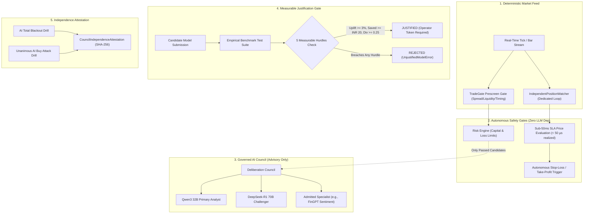

# Phase 36: AI Council Evolution & Deterministic Safety Decoupling Specification

## 1. Overview & Operational Mandate

The **AI Micro-Trading Agent** utilizes a multi-model reasoning council (primary analyst Qwen3 and adversarial challenger DeepSeek-R1) to evaluate market qualitative evidence, catalysts, and risk invalidation scenarios.

As the trading agent scales, expanding the AI Council with candidate specialist models (e.g. macro sentiment analysts, orderflow/microstructure specialists) must be governed with mathematical rigor:
1. **Measurable Justification Mandate**: Models are added to the active deliberative council **only when there is empirical, measurable justification**. Models that introduce redundant mirroring, latency bloat, or token cost drag without demonstrable performance uplift are strictly blocked.
2. **Absolute Safety Decoupling**: The deterministic **Trade Gate** and **Position Watcher** operate with **100% independence from AI model availability**. Total AI blackouts, API timeouts, or unhandled model failures cannot degrade or interrupt system execution safety.
3. **Consensus Override Immunity**: 100% unanimous AI model agreement (even at 0.99 conviction) **cannot override deterministic safety controls, capital ceilings (₹100/₹300), stop losses, or daily loss limits**.

---

## 2. Architecture & Deliberation Framework



---

## 3. Subsystem Specifications

### 3.1 Measurable Justification Hurdles
- Managed by [`ModelAdmissionGate`](file:///C:/Users/likit/Desktop/project/backend/app/council_evolution/admission_gate.py).
- Evaluates candidate models against [`MeasurableHurdles`](file:///C:/Users/likit/Desktop/project/backend/app/council_evolution/models.py):
  1. **Directional Accuracy Uplift**: $\ge +3.0\%$ win rate or precision increase over the baseline council.
  2. **Downside Capital Preserved**: $\ge \text{INR } 20.00$ capital protected through unique flaw detection/critiques.
  3. **Reasoning Diversity Index**: $\ge 0.25$ disagreement entropy / orthogonal rationale score (preventing echo-chamber mirroring).
  4. **P95 Latency Ceiling**: $\le 2500$ ms operational budget.
  5. **Token Economic Cost Ratio**: $\le 1.50\times$ baseline cost efficiency.

### 3.2 Candidate Scorecards & Admission
- Built-in candidate benchmark profiles:
  - `FINGPT-SENTIMENT-V1`: Macro Sentiment Specialist ($+4.2\%$ uplift, INR $28.50$ saved, $0.38$ diversity, $1450$ ms latency). Status: **JUSTIFIED**.
  - `REDUNDANT-ECHO-BOT`: Negative control ($+0.2\%$ uplift, INR $2.50$ saved, $0.06$ diversity, $2950$ ms latency). Status: **REJECTED**.
- Attempting to admit an unjustified candidate raises [`UnjustifiedModelError`](file:///C:/Users/likit/Desktop/project/backend/app/council_evolution/models.py).
- Admission requires signed operator token (`OPERATOR-COUNCIL-PHASE36-*`) and cryptographically logs mutations in SQLite `security_audit_ledger`.

### 3.3 Deterministic Safety Independence & Decoupling Guard
- Managed by [`CouncilIndependenceGuard`](file:///C:/Users/likit/Desktop/project/backend/app/council_evolution/independence_guard.py).
- **Outage Resilience**: Verifies that when all AI clients are offline / disconnected, [`DeterministicTradeGate`](file:///C:/Users/likit/Desktop/project/backend/app/gate/trade_gate.py) continues executing deterministic prescreen and risk gates cleanly without hanging.
- **Position Watcher Decoupling**: Verifies [`IndependentPositionWatcher`](file:///C:/Users/likit/Desktop/project/backend/app/watcher/position_watcher.py) evaluates price updates in sub-50ms (realized: 16–25 µs) and triggers hard stop exits with zero AI dependency.
- **AI Override Immunity**: Verifies that even 100% unanimous AI "STRONG BUY" conviction is blocked unconditionally if hard capital/risk limits are breached.
- Produces [`CouncilIndependenceAttestation`](file:///C:/Users/likit/Desktop/project/backend/app/council_evolution/models.py) with SHA-256 integrity hash.

---

## 4. Operational CLI & REST API Guide

### CLI Commands
```bash
# Display active council composition and summary
python backend/scripts/council_evolution_runner.py --status

# List candidate scorecards and justification statuses
python backend/scripts/council_evolution_runner.py --candidates

# Benchmark a candidate model
python backend/scripts/council_evolution_runner.py --benchmark FINGPT-SENTIMENT-V1

# Execute Trade Gate and Watcher independence drill
python backend/scripts/council_evolution_runner.py --audit-independence

# Admit a justified model with signed operator authorization
python backend/scripts/council_evolution_runner.py --admit FINGPT-SENTIMENT-V1 \
  --token OPERATOR-COUNCIL-PHASE36-VERIFIED-AUTH-TOKEN-12345

# Execute comprehensive Phase 36 audit
python backend/scripts/council_evolution_runner.py --audit
```

### REST API Endpoints
- `GET /api/v1/council-evolution/status`: Active council models and candidate summary.
- `GET /api/v1/council-evolution/candidates`: Candidate model justification scorecards.
- `POST /api/v1/council-evolution/evaluate-candidate`: Benchmark candidate against measurable hurdles.
- `POST /api/v1/council-evolution/admit-model`: Admit model to active council with operator token.
- `POST /api/v1/council-evolution/audit-independence`: Execute safety decoupling and blackout drill.
- `GET /api/v1/council-evolution/audit`: Master compliance audit report.
