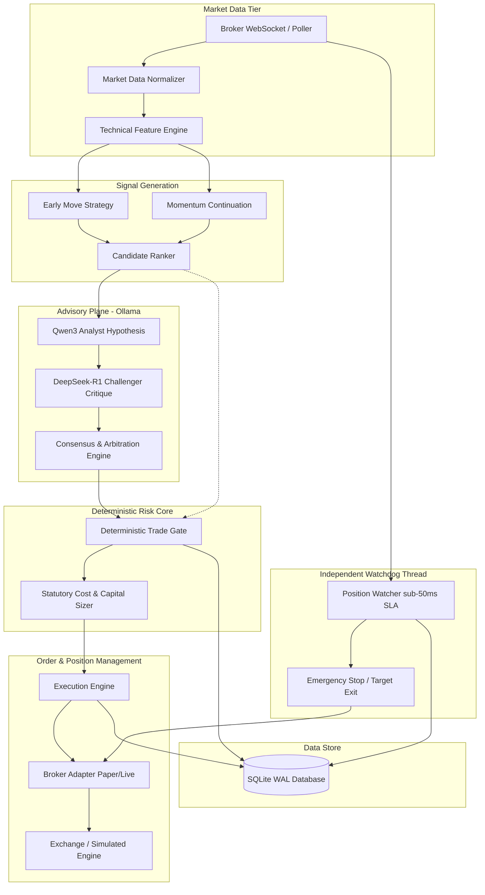

# Architecture Overview

The **AI Micro-Trading Agent** is architected as a local-first, zero-cloud-spend algorithmic micro-trading system. It combines high-performance deterministic financial execution with local dual-LLM qualitative reasoning.

---

## 1. Core Architectural Principles

1. **Local-First & ₹0 Cloud Spend**:
   - Zero recurring subscription costs or proprietary cloud API requirements.
   - Runs on local commodity hardware using open-source models (Qwen3 & DeepSeek-R1 via Ollama).
2. **Deterministic Risk Supremacy**:
   - Stop-loss execution, position sizing, exposure management, and market cutoff timers are 100% deterministic.
   - AI models serve purely advisory roles; they can never override risk gates or suppress stop orders.
3. **Three-Tier Process Isolation**:
   - **Tier 1: Presentation (React 18 / TypeScript)**: Visual dashboard strictly distinguishing system facts from AI speculations.
   - **Tier 2: Control Plane (FastAPI / Python 3.11)**: REST/WebSocket orchestration, market scanner, technical strategies, and AI Council.
   - **Tier 3: Execution & Watchdog (Position Watcher / SQLite WAL)**: Dedicated thread enforcing sub-50ms SLA on stop execution directly against broker abstraction.
4. **One-Writer Rule**:
   - Exactly one development agent or runtime writer modifies state at any time, preventing race conditions and split-brain states.

---

## 2. High-Level System Topology

---

## 3. Component Boundaries & Responsibility Matrix

| Subsystem | Threading Model | State Mutability | LLM Involvement | Latency SLA |
| :--- | :--- | :--- | :--- | :--- |
| **Market Data Normalizer** | Async event loop | Read-only input | None | < 1 ms |
| **Feature Engine** | In-process vectorized | Read-only | None | < 2 ms |
| **Candidate Ranker** | Async task | Read-only candidate list | None | < 5 ms |
| **AI Council (Qwen3 + R1)** | Async background worker | Advisory output only | Local Ollama | 1–5 seconds |
| **Deterministic Trade Gate** | In-process synchronous | TradePlan approval/rejection | **STRICTLY ZERO** | < 1 ms |
| **Capital & Cost Engine** | Synchronous | Validates sizing vs ₹100/₹300 limits | None | < 0.5 ms |
| **Execution Engine** | Async with atomic lock | Order state machine updates | None | < 10 ms |
| **Position Watcher** | Dedicated background thread | Position state & exits | **STRICTLY ZERO** | < 50 ms (hard) |
| **SQLite Persistence** | Thread-safe connection pool | ACID WAL writes | None | < 2 ms |

---

## 4. Crash Recovery & Resilience Architecture

The system utilizes SQLite WAL (Write-Ahead Logging) mode to guarantee durability across unexpected halts or power events:
1. **Startup Recovery (`RestartRecoveryManager`)**:
   - On application boot, the engine inspects the database for active positions.
   - Reconstructs running capital balances, high water marks, and open orders.
   - Immediately queries broker adapter to reconcile local position quantities against remote state.
2. **Desynchronization Safe-Action**:
   - If broker and database state diverge, the system immediately halts new order submissions (`SYSTEM_HALTED`) and triggers operator alerts.
