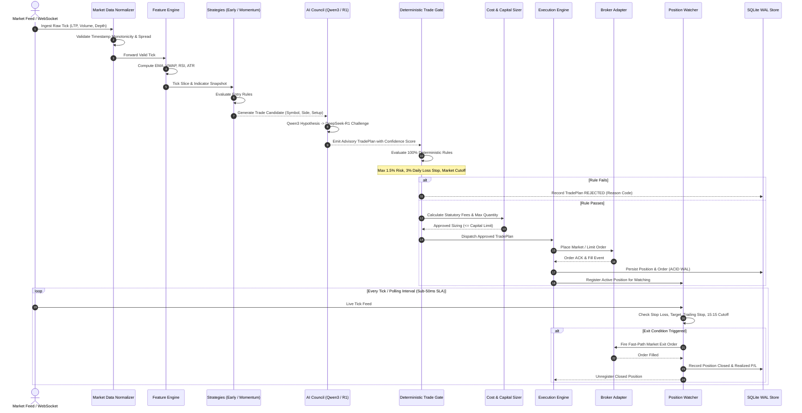
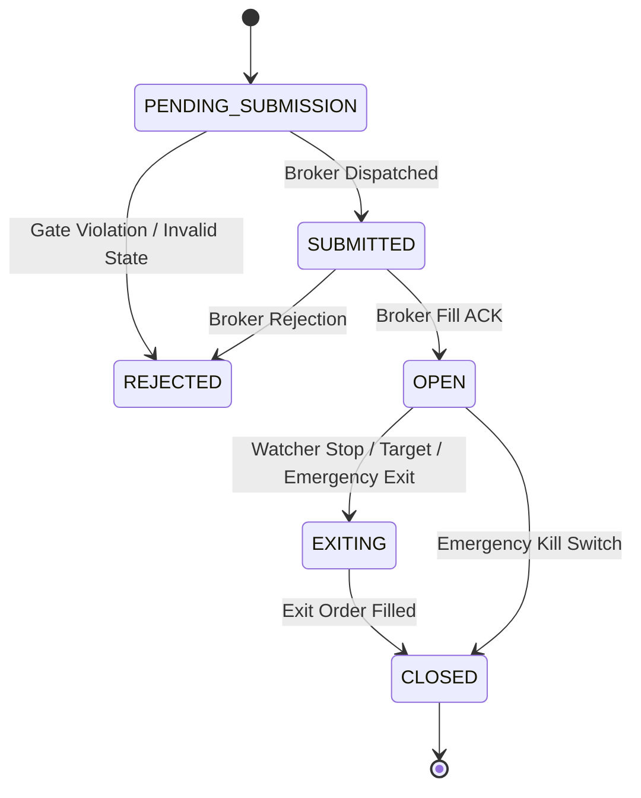

# End-to-End Data Flow & State Management

This document details the lifecycle of market ticks, candidate signals, AI deliberation records, order execution states, and position lifecycle updates across the system.

---

## 1. Trade Data Lifecycle

---

## 2. Execution State Machine

Orders and positions progress strictly through deterministic states defined in `backend/app/models/contracts.py`:

### State Definitions
1. **PENDING_SUBMISSION**: Created by Execution Engine, undergoing pre-submission lock.
2. **SUBMITTED**: Transmitted to broker adapter; awaiting exchange confirmation.
3. **OPEN**: Filled; active exposure monitored by Position Watcher thread.
4. **EXITING**: Exit trigger fired (Hard Stop, Take Profit, Time Expiry, or Cutoff); exit order in flight.
5. **CLOSED**: Completely exited, fees deducted, realized P/L locked to ledger.
6. **REJECTED**: Refused by Trade Gate risk limits or broker margin rejection.
7. **SYSTEM_HALTED**: Emergency kill-switch activated; all open positions forcefully closed.

---

## 3. Database Schema & WAL Persistence

The persistent layer is backed by SQLite with `PRAGMA journal_mode=WAL` and `PRAGMA synchronous=NORMAL`:
- **`positions`**: Open and closed positions with entry price, exit price, quantities, realized P/L, fees, and exit trigger tags.
- **`orders`**: Individual order execution events, broker order IDs, timestamps, and fill prices.
- **`trade_plans`**: Candidates evaluated by strategies and AI Council, including approval status and rejection reasons.
- **`capital_snapshots`**: Periodic and event-driven capital accounting snapshots (total capital, available cash, high water mark).
- **`council_records`**: Advisory deliberative text from Qwen3 and DeepSeek-R1 with agreement scores.
- **`system_audit_logs`**: Tamper-evident operational events, config validations, and error traces.
