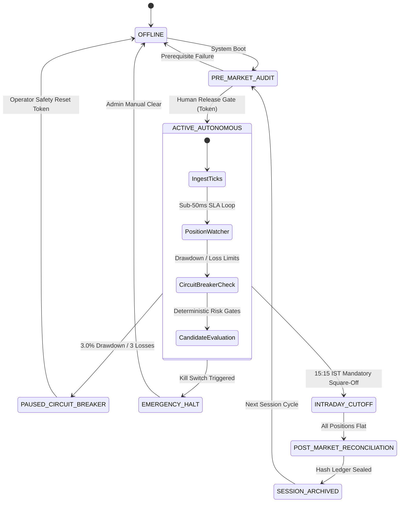

# Phase 37: Long-Term Autonomous System Architecture & Governance Manual

## Executive Overview
Phase 37 establishes the architecture for long-term, multi-session autonomous trading operations. In strict accordance with the Post-V1 Control Framework, broader automation and dynamic multi-strategy portfolio management are permitted **only after all prior foundational phases (Phases 21 through 36) have been verified**, and **strictly under explicit release gates requiring human authorization tokens**.



---

## 1. Multi-Phase Prerequisite Verification Gate
Before any autonomous trading session can be activated, the system executes a 7-dimensional automated audit across earlier phases:

| Dimension | Scope & Invariant | Verified By |
| :--- | :--- | :--- |
| `OPS_PREFLIGHT` | SQLite WAL journal mode active, integrity check `ok`, health probes responsive | [`LongTermPrerequisiteGate`](file:///C:/Users/likit/Desktop/project/backend/app/long_term_autonomous/prerequisite_gate.py) |
| `CAPITAL_LIMITS` | Initial capital $\le \text{₹}100$, autonomous ceiling $\le \text{₹}300$, trade risk $\le 1.5\%$, `IS_PAPER_TRADING=True` | [`CapitalConfig`](file:///C:/Users/likit/Desktop/project/backend/app/capital/config.py) |
| `PORTFOLIO_CONCENTRATION` | Gross exposure $\le 100\%$, strategy $\le 60\%$, symbol $\le 40\%$, sector $\le 50\%$ | [`ConcentrationEngine`](file:///C:/Users/likit/Desktop/project/backend/app/portfolio/concentration_engine.py) |
| `DISASTER_RECOVERY` | WAL rehydration restores active positions and capital state idempotently | [`RestartRecoveryManager`](file:///C:/Users/likit/Desktop/project/backend/app/db/recovery.py) |
| `SECURITY_LEAST_PRIVILEGE` | RBAC hierarchy (`ADMIN` > `OPERATOR` > `VIEWER`) and tamper-evident SHA-256 chain | [`TamperEvidentAuditLogger`](file:///C:/Users/likit/Desktop/project/backend/app/security/tamper_log.py) |
| `RESEARCH_SANDBOX` | Quarantined datasets, zero leakage, $\ge 30$ trades, Sharpe $\ge 1.30$, DD $\le 15\%$ | [`ExplicitPromotionGate`](file:///C:/Users/likit/Desktop/project/backend/app/sandbox/promotion_gate.py) |
| `AI_COUNCIL_DECOUPLING` | Position Watcher sub-50ms SLA ($< 1\text{ ms}$ realized) and Trade Gate zero-LLM resilience | [`CouncilIndependenceGuard`](file:///C:/Users/likit/Desktop/project/backend/app/council_evolution/independence_guard.py) |

If any dimension fails, the prerequisite gate blocks session activation with `PrerequisiteNotMetError`.

---

## 2. Dynamic Strategy Portfolio Governance

The [`AutonomousPortfolioGovernor`](file:///C:/Users/likit/Desktop/project/backend/app/long_term_autonomous/portfolio_governor.py) oversees multiple strategies across long horizons:

### Strategy Lifecycle Stages

```mermaid
flowchart LR
    RESEARCH["1. RESEARCH (Sandbox)"] -->|Hurdles Passed| CANDIDATE["2. CANDIDATE (Zero Allocation)"]
    CANDIDATE -->|Release Token| PROBATION["3. PROBATION (Max 15% Cap)"]
    PROBATION -->|Validated Stability| ACTIVE["4. ACTIVE (Full Allocation)"]
    ACTIVE -->|Drawdown > 15% / Win Rate < 40%| DEGRADED["5. DEGRADED (Capital Frozen)"]
    DEGRADED -->|Negative Expectancy| DECOMMISSIONED["6. DECOMMISSIONED (Archived)"]
```


### Automated Edge Degradation Quarantine
The governor continuously evaluates rolling performance metrics:
- **Rolling Win Rate**: If $\text{win rate} < 40.0\%$ over $\ge 15$ trades, strategy is automatically transitioned to `DEGRADED`.
- **Max Drawdown**: If $\text{drawdown} > 15.0\%$, capital allocation is instantly frozen to $\text{₹}0.00$.
- **Consecutive Losses**: If $\ge 4$ consecutive losing trades occur, strategy is quarantined and alerted to the operator.
- Every quarantine event is cryptographically sealed in the tamper-evident audit ledger.

### Governed Dynamic Rebalancing
The governor provides mathematical rebalance proposals:
1. `EQUAL_WEIGHT`: Equal allocation divided among all active, non-degraded strategies.
2. `SHARPE_WEIGHTED`: Capital allocated in proportion to trailing Sharpe ratios, capped at $60.0\%$ maximum strategy concentration limit.
3. **Release Gate Required**: Proposals cannot be applied automatically. Application strictly requires an explicit operator token (`RELEASE-PORTFOLIO-REBALANCE-*`).

---

## 3. Explicit Release Gates & Human Approval Protocol

All critical system mutations require explicit authorization tokens:

| Release Gate Type | Allowed Token Formats | Enforced Boundary |
| :--- | :--- | :--- |
| `SYSTEM_ACTIVATION` | `RELEASE-AUTONOMOUS-SESSION-*` | Requires 7/7 prerequisite audit pass |
| `STRATEGY_PROMOTION` | `RELEASE-STRATEGY-PROMOTION-*` | Max $20\%$ for probation; max $60\%$ for active |
| `PORTFOLIO_REBALANCE` | `RELEASE-PORTFOLIO-REBALANCE-*` | Target weights must sum to exactly $100.00\%$ |
| `CAPITAL_TIER_SCALE` | `RELEASE-TIER-UPGRADE-*` | Capped at ₹300 autonomous ceiling |
| `SAFETY_RESET` | `RELEASE-SAFETY-RESET-*` | Requires cleared invariant condition |

### Cryptographic Audit Chain
Every release decision (approved or rejected) appends an immutable block to the `security_audit_ledger` with:
$$\text{RecordHash}_n = \text{SHA-256}\left(\text{RecordHash}_{n-1} \parallel \text{Timestamp} \parallel \text{OperatorID} \parallel \text{Role} \parallel \text{Action} \parallel \text{Resource} \parallel \text{DetailsJSON}\right)$$

---

## 4. End-to-End Autonomous Lifecycle Orchestration

The [`LongTermAutonomousOrchestrator`](file:///C:/Users/likit/Desktop/project/backend/app/long_term_autonomous/lifecycle_orchestrator.py) enforces intraday execution discipline:

1. **Pre-Market Audit (08:45 IST)**: Checks DB WAL, rehydrates state, runs prerequisite audit.
2. **Session Start (09:15 IST)**: Enforces operator release token before transitioning to `ACTIVE_AUTONOMOUS`.
3. **Intraday Execution (09:15 - 15:15 IST)**:
   - Independent sub-50ms position watcher evaluation on every incoming tick.
   - 3.0% daily drawdown circuit breaker.
   - 3 consecutive losses breaker.
4. **Mandatory Cutoff (15:15 IST)**: Mandatory auto-square-off closes all remaining open positions, guaranteeing zero overnight risk.
5. **Post-Market Reconciliation (15:30 IST)**: Reconciles cash, PnL, trades, verifies ledger integrity, archives session summary.

---

## 5. Operator CLI & API Reference

### CLI Usage (`backend/scripts/long_term_autonomous_runner.py`)
```powershell
# Inspect system status and portfolio
python backend/scripts/long_term_autonomous_runner.py --status

# Audit multi-phase prerequisites
python backend/scripts/long_term_autonomous_runner.py --check-prerequisites

# Run full simulated autonomous session lifecycle
python backend/scripts/long_term_autonomous_runner.py --run-session --token "RELEASE-AUTONOMOUS-SESSION-DEMO-2026"

# Dynamic portfolio rebalance with approval token
python backend/scripts/long_term_autonomous_runner.py --rebalance --token "RELEASE-PORTFOLIO-REBALANCE-OPERATOR-2026"

# Verify release gate token
python backend/scripts/long_term_autonomous_runner.py --verify-release SYSTEM_ACTIVATION --token "RELEASE-AUTONOMOUS-SESSION-VALID"
```

### REST API Endpoints
- `GET /api/v1/long-term-autonomous/status`: Real-time system state and portfolio metrics.
- `POST /api/v1/long-term-autonomous/prerequisites/verify`: Audit 7 prerequisite dimensions.
- `POST /api/v1/long-term-autonomous/session/start`: Activate session with release token.
- `POST /api/v1/long-term-autonomous/session/cutoff`: Trigger 15:15 IST square-off.
- `POST /api/v1/long-term-autonomous/session/reconcile`: Post-market reconciliation.
- `POST /api/v1/long-term-autonomous/portfolio/rebalance/propose`: Propose dynamic weights.
- `POST /api/v1/long-term-autonomous/portfolio/rebalance/apply`: Apply weights with token.
- `POST /api/v1/long-term-autonomous/safety/reset`: Reset safety halt with token.
