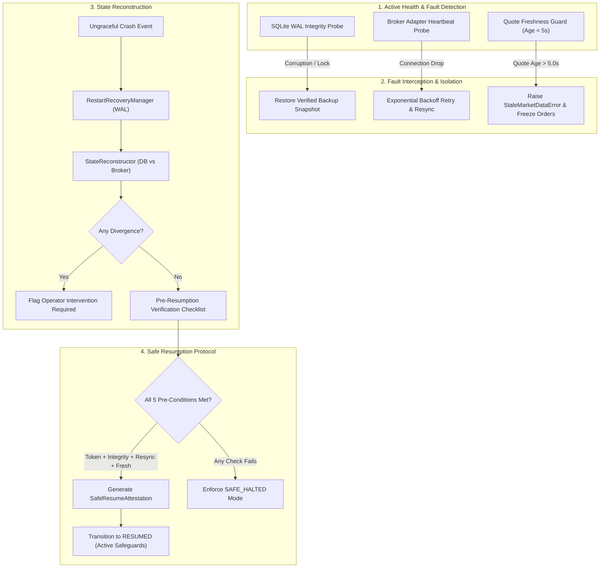

# Phase 33: Disaster Recovery, Fault Resilience & Business Continuity Specification

## 1. Overview & Operational Mandate

The **AI Micro-Trading Agent** operates in autonomous and semi-autonomous environments where system stability, transaction idempotency, and operational continuity are vital to protecting capital.

Phase 33 implements and audits a multi-scenario disaster recovery framework addressing 6 fault categories:
1. **Ungraceful Process Crash & Restart**: Rehydration of in-memory state (equity, HWM, drawdown, positions, active orders) from SQLite WAL storage.
2. **Broker Disconnect & Session Drop**: Connection loss detection, exponential backoff retries, and post-reconnect order book and position reconciliation.
3. **Stale Market Data Handling**: Timestamp-based quote freshness auditing and feed heartbeat monitoring; deterministic trade blocking upon feed delay or gap.
4. **Database Resilience & Corruption Failover**: SQLite WAL integrity audits, atomic WAL truncation checkpoints, and automated backup restore on corruption.
5. **Duplicate-Order Prevention & Idempotency Across Restarts**: Cryptographic SHA-256 order fingerprinting and persistent idempotency tracking preventing double execution.
6. **State Reconstruction & Safe Resumption Governance**: Formal pre-resumption checklist ensuring zero unmanaged divergence before operator-authorized restart.

---

## 2. Architecture & Continuity Workflow



---

## 3. Subsystem Specifications

### 3.1 Ungraceful Crash & Restart Recovery
- Managed by [`RestartRecoveryManager`](file:///C:/Users/likit/Desktop/project/backend/app/db/recovery.py).
- On process start, scans SQLite database for:
  - `capital_state`: Rehydrates `available_capital`, `deployed_capital`, `realized_pnl`, `high_water_mark`, and `daily_drawdown`.
  - `positions`: Restores open positions into [`IndependentPositionWatcher`](file:///C:/Users/likit/Desktop/project/backend/app/watcher/position_watcher.py) with exact hard-stop prices.
  - `orders`: Re-registers non-terminal active orders into [`ExecutionEngine`](file:///C:/Users/likit/Desktop/project/backend/app/execution/execution_engine.py).

### 3.2 Broker Disconnect & Auto-Reconnect
- Managed by [`BrokerResilienceManager`](file:///C:/Users/likit/Desktop/project/backend/app/disaster_recovery/broker_resilience.py).
- Probes `broker.is_connected`.
- Executes exponential backoff retry loop (`initial_delay=0.1s`, `factor=2.0`, `max_retries=3`).
- On successful reconnection:
  - Resynchronizes pending order events against broker order history.
  - Executes full position audit via `broker.reconcile()`.

### 3.3 Stale Market Data Guard
- Managed by [`StaleDataGuard`](file:///C:/Users/likit/Desktop/project/backend/app/disaster_recovery/stale_data_guard.py).
- Thresholds:
  - `max_quote_age_seconds`: 5.0 seconds.
  - `max_feed_gap_seconds`: 10.0 seconds.
- Pre-trade assertion: `stale_guard.assert_quote_fresh(symbol)`.
- If quote age exceeds threshold or no quote is registered, raises `StaleMarketDataError` and aborts trade admission.

### 3.4 Database Resilience & Backup Failover
- Managed by [`DatabaseResilienceManager`](file:///C:/Users/likit/Desktop/project/backend/app/disaster_recovery/db_resilience.py).
- Runs `PRAGMA integrity_check`, `PRAGMA journal_mode`, and `PRAGMA foreign_keys`.
- Executes atomic WAL truncation checkpoints (`PRAGMA wal_checkpoint(TRUNCATE)`).
- On corruption detection, automatically initiates failover to the latest verified SQLite snapshot via [`BackupManager`](file:///C:/Users/likit/Desktop/project/backend/app/ops/backup_manager.py), verifying cryptographic SHA-256 hashes prior to restore.

### 3.5 Persistent Idempotency Across Restarts
- Managed by [`IdempotencyManager`](file:///C:/Users/likit/Desktop/project/backend/app/disaster_recovery/idempotency_manager.py).
- Computes cryptographic order fingerprints:
  $$\text{Fingerprint} = \text{SHA256}(\text{symbol} : \text{side} : \text{qty} : \text{price} : \text{plan\_id} : \text{time\_bucket})$$
- Stores records in SQLite table `order_idempotency_ledger` with index on fingerprint and timestamp.
- Rejects identical `client_order_id` or identical fingerprint within deduplication window (60.0s), surviving process restarts.

### 3.6 Cross-Ledger State Reconstruction
- Managed by [`StateReconstructor`](file:///C:/Users/likit/Desktop/project/backend/app/disaster_recovery/state_reconstructor.py).
- Compares DB positions and equity against broker positions and cash balance.
- Flags:
  - Orphaned positions (broker reports position, DB missing).
  - Phantom positions (DB reports position, broker missing).
  - Quantity mismatches.
  - Cash divergence ($> ₹0.05$).

### 3.7 Safe Resumption Protocol
- Managed by [`SafeResumeController`](file:///C:/Users/likit/Desktop/project/backend/app/disaster_recovery/safe_resume.py).
- Resumption requires passing all 5 points:
  1. `operator_token.startswith("OPERATOR-RESUME-")`
  2. `db_resilience.evaluate_db_health().integrity_ok == True`
  3. `broker_resilience.check_connection() == True`
  4. `state_reconstructor.reconstruct_and_reconcile().is_divergent == False`
  5. `stale_data_guard.check_quote_freshness().is_stale == False`
- Upon passing, issues formal `SafeResumeAttestation` and transitions status to `RESUMED`.

---

## 4. Operational Commands & API Endpoints

### CLI Runner
```bash
# Execute comprehensive multi-scenario disaster drill
python backend/scripts/disaster_recovery_runner.py --run-drill

# Output structured JSON audit
python backend/scripts/disaster_recovery_runner.py --run-drill --json

# Query current system continuity status
python backend/scripts/disaster_recovery_runner.py --status
```

### REST API
- `GET /api/v1/disaster-recovery/status`: System continuity, DB health, broker connectivity.
- `POST /api/v1/disaster-recovery/check-stale-data`: Symbol quote freshness assessment.
- `POST /api/v1/disaster-recovery/reconstruct-state`: Cross-ledger reconciliation between DB and broker.
- `POST /api/v1/disaster-recovery/safe-resume`: Operator-authorized safe resumption request.
- `POST /api/v1/disaster-recovery/run-drill`: Run automated 6-scenario disaster recovery test drill.
