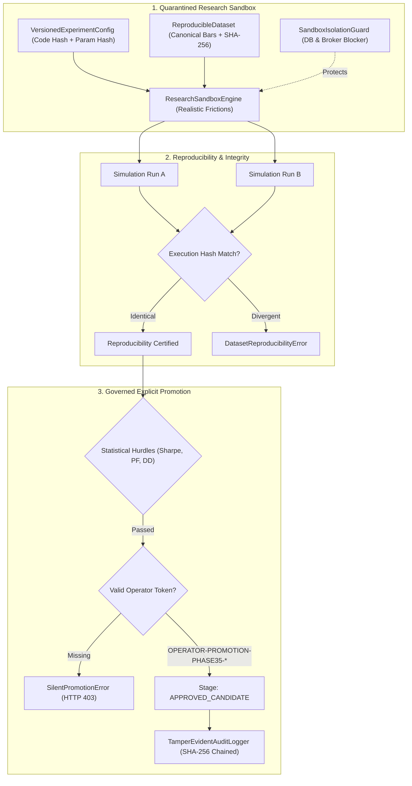

# Phase 35: Research Sandbox & Governed Promotion Specification

## 1. Overview & Operational Mandate

The **AI Micro-Trading Agent** requires experimental research to be isolated strictly from production trading operations. Unverified or overfitting alpha hypotheses must never interact with live broker connectivity, real capital, or production persistence databases.

**Phase 35: Research Sandbox** establishes an isolated, mathematically reproducible laboratory environment with:
1. **Production Isolation & Quarantine**: Absolute separation of sandbox runs from production SQLite databases, live broker adapters, and real-time execution pipelines.
2. **Reproducible Datasets**: Immutable, cryptographically fingerprinted market datasets (`SHA-256` of canonical bar records and metadata) with fixed seeds.
3. **Versioned Code & Configuration**: Deterministic binding of strategy code hashes, parameter states, and risk thresholds into a canonical `config_hash`.
4. **Exact Mathematical Reproducibility**: Verification that re-running simulations on frozen datasets yields identical execution hashes and metrics down to floating-point precision ($\Delta = 0.0$).
5. **Explicit Governed Promotion Protocol**: A multi-stage gate prohibiting silent production entry, enforcing strict statistical hurdles (Sharpe $\ge 1.2$, Profit Factor $\ge 1.3$, Drawdown $\le 2.5\%$, Trades $\ge 20$), and recording promotions into the cryptographic `security_audit_ledger`.

---

## 2. Architecture & Quarantine Framework



---

## 3. Subsystem Specifications

### 3.1 Sandbox Isolation Guard
- Managed by [`SandboxIsolationGuard`](file:///C:/Users/likit/Desktop/project/backend/app/sandbox/isolation_guard.py).
- Enforces strict path isolation: any attempt by sandbox components to open [`settings.DATABASE_PATH`](file:///C:/Users/likit/Desktop/project/backend/app/core/config.py) raises [`ProductionIsolationError`](file:///C:/Users/likit/Desktop/project/backend/app/sandbox/models.py).
- Prohibits attachment of live broker adapters or live order queues.
- Provides context manager `isolated_sandbox_scope()` to tag thread execution contexts.

### 3.2 Reproducible Datasets & Hashing
- Managed by [`ReproducibleDatasetRegistry`](file:///C:/Users/likit/Desktop/project/backend/app/sandbox/dataset_registry.py).
- Canonical bars are fingerprinted using [`compute_bars_sha256`](file:///C:/Users/likit/Desktop/project/backend/app/sandbox/dataset_registry.py):
  $$\text{hash} = \text{SHA256}(\text{seed} : \text{bar}_1 : \dots : \text{bar}_n)$$
- Built-in baseline datasets:
  - `DATASET-NIFTY-MICRO-2026-TRAIN`: 100 bars, seed 42.
  - `DATASET-NIFTY-MICRO-2026-TEST`: 100 bars, seed 101.
- `verify_integrity(dataset_id)` re-evaluates all bar bytes to detect any manual tampering.

### 3.3 Versioned Experiment Configuration
- Managed by [`VersionedConfigManager`](file:///C:/Users/likit/Desktop/project/backend/app/sandbox/versioned_config.py).
- Computes canonical JSON `config_hash`:
  $$\text{config\_hash} = \text{SHA256}(\text{strategy} : \text{parameters} : \text{risk\_limits} : \text{code\_hash} : \text{dataset\_hash})$$
- Built-in baseline configurations:
  - `EXP-SANDBOX-EMA-V1`: EMA 9/21 Dynamic Pullback.
  - `EXP-SANDBOX-ORB-V1`: 15-Minute Opening Range Breakout.

### 3.4 Deterministic Simulation & Frictions
- Managed by [`ResearchSandboxEngine`](file:///C:/Users/likit/Desktop/project/backend/app/sandbox/sandbox_engine.py).
- Models Indian market frictions:
  - Statutory taxes (STT, exchange turnover, SEBI charges, GST, stamp duty): 0.03% (3 bps).
  - Round-trip slippage: INR 0.15 per micro contract.
- Produces [`SandboxExecutionMetrics`](file:///C:/Users/likit/Desktop/project/backend/app/sandbox/models.py) and unique `execution_hash`.

### 3.5 Governed Promotion Gate
- Managed by [`ExplicitPromotionGate`](file:///C:/Users/likit/Desktop/project/backend/app/sandbox/promotion_gate.py).
- Enforces statistical thresholds:
  - Total Trades $\ge 20$
  - Win Rate $\ge 50.0\%$
  - Profit Factor $\ge 1.30$
  - Annualized Sharpe Ratio $\ge 1.20$
  - Maximum Drawdown $\le 2.50\%$
- Requires non-silent signed operator token (`OPERATOR-PROMOTION-PHASE35-*` or valid `OPTOK.*`).
- Cryptographically logs promotion events in `security_audit_ledger`.

---

## 4. Operational CLI & REST API Guide

### CLI Commands
```bash
# Probe sandbox quarantine status
python backend/scripts/sandbox_runner.py --status

# List registered datasets and configurations
python backend/scripts/sandbox_runner.py --list

# Run simulation in sandbox
python backend/scripts/sandbox_runner.py --run EXP-SANDBOX-EMA-V1

# Verify exact mathematical reproducibility
python backend/scripts/sandbox_runner.py --verify EXP-SANDBOX-EMA-V1

# Submit strategy for governed promotion
python backend/scripts/sandbox_runner.py --promote EXP-SANDBOX-EMA-V1 \
  --token OPERATOR-PROMOTION-PHASE35-VERIFIED-AUTH-KEY-12345 \
  --rationale "Validated intraday alpha with sub-2% DD"
```

### REST API Endpoints
- `GET /api/v1/sandbox/status`: Quarantine state and subsystem telemetry.
- `GET /api/v1/sandbox/datasets`: List registered reproducible datasets.
- `GET /api/v1/sandbox/datasets/{id}/verify`: Verify dataset cryptographic integrity.
- `GET /api/v1/sandbox/experiments`: List registered versioned experiment configurations.
- `POST /api/v1/sandbox/experiments/run`: Run simulation in quarantined sandbox.
- `POST /api/v1/sandbox/experiments/verify-reproducibility`: Run consecutive simulations and verify reproducibility.
- `POST /api/v1/sandbox/promote`: Submit candidate strategy for promotion with operator authorization.
