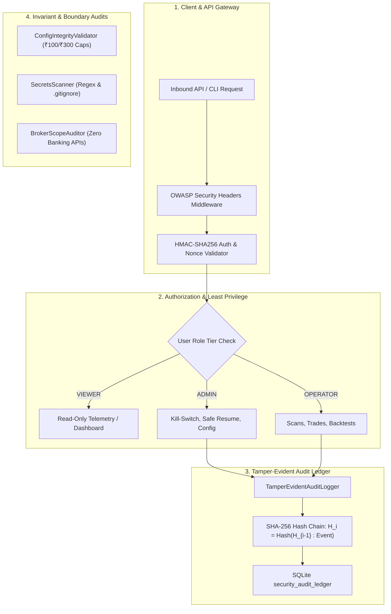

# Phase 34: Security Hardening, Cryptographic Audit Ledger & Least Privilege Specification

## 1. Overview & Operational Security Mandate

The **AI Micro-Trading Agent** operates with direct access to market financial instruments, execution order routing, and real-time capital allocation. System security is an absolute prerequisite to protecting assets.

Phase 34 implements and verifies 8 core security hardening dimensions:
1. **Secrets Sanitization & Exclusion**: Zero committed secrets, automated regex pattern scanning, dynamic secret masking, and strict `.gitignore` rules.
2. **Authentication (AuthN)**: Cryptographic HMAC-SHA256 bearer tokens with constant-time signature validation (`hmac.compare_digest`), replay-preventing nonces, expiration, and revocation.
3. **Authorization & Role-Based Access Control (AuthZ / RBAC)**: Strict three-tier hierarchy (`ADMIN > OPERATOR > VIEWER`) enforcing the principle of least privilege.
4. **Dependency Vulnerability & Supply Chain**: Full dependency pinning verification in `pyproject.toml` ensuring reproducible, un-hijackable builds.
5. **Network Exposure & Attack Surface Minimization**: Local interface binding, CORS restriction, and OWASP defensive response headers (`X-Content-Type-Options: nosniff`, `X-Frame-Options: DENY`, `CSP`, `HSTS`, `Referrer-Policy`).
6. **Tamper-Evident Cryptographic Audit Logging**: Immutable SQLite audit log chained with SHA-256 hashes linking every entry to its predecessor, providing mathematically verifiable integrity proofs.
7. **Configuration Integrity & Immutable Bounds**: Cryptographic checksum verification enforcing immutable safety limits (Initial Capital $\le ₹100$, Autonomous Cap $\le ₹300$, Max Risk $\le 1.5\%$, Daily Drawdown $\le 3.0\%$, 15:15 IST cutoff, `IS_PAPER_TRADING=True`).
8. **Broker Permissions & Scope Principle of Least Privilege**: Verification that broker sessions possess strictly order placement and quote read capabilities, with zero banking, fund transfer, or credential generation access.

---

## 2. Architecture & Security Framework



---

## 3. Subsystem Specifications

### 3.1 Secrets Sanitization & Masking
- Managed by [`SecretsScanner`](file:///C:/Users/likit/Desktop/project/backend/app/security/secrets_scanner.py).
- Scans source trees (`backend/app`, `backend/scripts`, `frontend/src`) against regex definitions for AWS, GitHub, OpenAI, Kite, and private keys.
- Sanitizes logs and telemetry using `mask_secret(text, visible_prefix=3, visible_suffix=3)`.
- Verifies `.gitignore` excludes `.env`, `*.db`, `backups/`, `*.log`, `.venv`.

### 3.2 HMAC-SHA256 Authentication
- Managed by [`AuthenticationManager`](file:///C:/Users/likit/Desktop/project/backend/app/security/auth.py).
- Tokens formatted as `OPTOK.<base64_payload>.<hmac_signature>`.
- Constant-time verification prevents side-channel timing attacks.
- Enforces expiration timestamps and maintains a revocation denylist.

### 3.3 RBAC Least Privilege Matrix
- Managed by [`AccessControlManager`](file:///C:/Users/likit/Desktop/project/backend/app/security/rbac.py).
- Defined roles:
  - `VIEWER` (Level 1): Read-only metrics, telemetry, and reports.
  - `OPERATOR` (Level 2): Strategy scans, paper orders, backtests.
  - `ADMIN` (Level 3): Emergency controls, kill switch, safe resume, secret rotation.
- Enforced via FastAPI dependency: `require_role(UserRole.ADMIN)`.

### 3.4 Tamper-Evident Cryptographic Audit Logging
- Managed by [`TamperEvidentAuditLogger`](file:///C:/Users/likit/Desktop/project/backend/app/security/tamper_log.py).
- Maintains a cryptographic SHA-256 hash chain in SQLite table `security_audit_ledger`:
  $$\text{record\_hash}_i = \text{SHA256}(\text{prev\_hash}_{i-1} : \text{timestamp} : \text{operator\_id} : \text{action} : \text{resource} : \text{details\_json})$$
- `verify_chain_integrity()` walks the chain from genesis block (`"0"*64`) to the latest entry, detecting any record modification, deletion, or insertion.

### 3.5 Configuration Integrity & Hard Caps
- Managed by [`ConfigIntegrityValidator`](file:///C:/Users/likit/Desktop/project/backend/app/security/config_integrity.py).
- Hard caps:
  - `INITIAL_CAPITAL <= ₹100.00`
  - `AUTONOMOUS_CAPITAL_THRESHOLD <= ₹300.00`
  - `IS_PAPER_TRADING == True`
- Computes canonical SHA-256 configuration checksum; raises `ConfigurationTamperError` if any bound is breached.

### 3.6 Broker Permissions & Scope Isolation
- Managed by [`BrokerScopeAuditor`](file:///C:/Users/likit/Desktop/project/backend/app/security/broker_scope.py).
- Confirms zero exposure of banking endpoints (`withdraw_funds`, `transfer_cash`, `add_bank_account`).
- Enforces strict paper trading adapter isolation when `IS_PAPER_TRADING=True`.

---

## 4. Operational Commands & API Endpoints

### CLI Runner
```bash
# Execute comprehensive 8-dimension security audit
python backend/scripts/security_audit_runner.py --audit

# Verify cryptographic hash chain of audit log
python backend/scripts/security_audit_runner.py --verify-tamper-log

# Issue HMAC-SHA256 operator bearer token
python backend/scripts/security_audit_runner.py --issue-token --role ADMIN --operator-id CHIEF_OPERATOR

# Output audit results as structured JSON
python backend/scripts/security_audit_runner.py --audit --json
```

### REST API Endpoints
- `GET /api/v1/security/audit`: Full 8-dimension security audit report.
- `POST /api/v1/security/verify-tamper-log`: Cryptographic verification of audit ledger hash chain.
- `POST /api/v1/security/scan-secrets`: Automated scan of project files and `.gitignore`.
- `POST /api/v1/security/issue-token`: Issue HMAC-SHA256 authenticated bearer tokens.
- `GET /api/v1/security/config-integrity`: Evaluate live settings against immutable safety caps.
