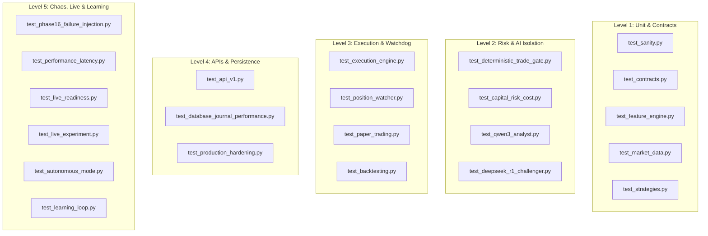

# Testing Strategy & Test Suite Map

The AI Micro-Trading Agent is validated by a rigorous test suite comprising 251 automated tests across 22 distinct test modules.

---

## 1. Test Suite Architecture



---

## 2. Test Module Breakdown

| Module | Test Count | Scope & Verification |
| :--- | :---: | :--- |
| `test_sanity.py` | 1 | Basic environment configuration and settings loader. |
| `test_contracts.py` | 3 | Pydantic contracts, Decimal serialization, and state models. |
| `test_market_data.py` | 6 | Feed normalizer, spread calculations, and monotonic clock checks. |
| `test_feature_engine.py` | 14 | EMA, RSI, ATR, VWAP mathematical accuracy and rolling window speed. |
| `test_strategies.py` | 8 | Early Move and Momentum Continuation entry/exit condition validation. |
| `test_deterministic_trade_gate.py` | 14 | 100% deterministic risk constraints: risk %, drawdown, cutoff time. |
| `test_capital_risk_cost.py` | 13 | Statutory Indian costs (STT, SEBI, GST, stamp duty) and position sizing. |
| `test_qwen3_analyst.py` | 14 | Hypothesis prompt formatting, JSON response parsing, and error fallbacks. |
| `test_deepseek_r1_challenger.py` | 21 | Adversarial critique generation, counter-theses, and arbitration consensus. |
| `test_execution_engine.py` | 15 | Order lifecycle state transitions, fill processing, and DB persistence. |
| `test_position_watcher.py` | 15 | Sub-50ms SLA verification, hard stops, trailing stops, and 15:15 cutoff. |
| `test_api_v1.py` | 18 | Safe query routes, blocked `POST /orders`, and guarded mutation endpoints. |
| `test_backtesting.py` | 17 | Historical tick replay, simulated slippage, and P/L accounting. |
| `test_paper_trading.py` | 10 | Simulated execution environment and virtual portfolio tracking. |
| `test_database_journal_performance.py` | 8 | SQLite WAL mode, concurrent write locking, and high-frequency commits. |
| `test_phase16_failure_injection.py` | 14 | Chaos engineering: network drop, stale feed, broker error, power-cut crash. |
| `test_performance_latency.py` | 10 | Benchmarks for Watcher loop, indicator calculations, and DB write latency. |
| `test_live_readiness.py` | 12 | 14-dimension preflight checks and safety interlocks for live activation. |
| `test_live_experiment.py` | 8 | ₹100 micro-capital experiment engine and telemetry monitor. |
| `test_autonomous_mode.py` | 12 | ₹300 autonomous mode with multi-tier risk controls and human approval gates. |
| `test_learning_loop.py` | 8 | 8-dimension post-trade analytics and versioned strategy recommendations. |
| `test_production_hardening.py` | 10 | Hot backup creation/verification/restore, config integrity, and health probes. |
| **Total** | **251** | **All 251 tests passing with 0 failures** |

---

## 3. Running the Test Suite

```bash
# Run entire test suite
pytest

# Run a specific module
pytest backend/tests/test_position_watcher.py -v

# Run with coverage report
pytest --cov=backend/app backend/tests/
```
