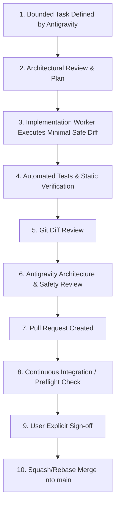

# GitHub Workflow & Development Agent Rules

This document defines the permanent repository workflow, branching strategy, pull request rules, and multi-agent governance controls for `ai-agent-trading`.

---

## 1. Governance & Agent Hierarchy

```
USER (Final Authority & Product Owner)
  ↓
ANTIGRAVITY (Project Commander / Lead Architect / Reviewer / QA Coordinator)
  ↓
IMPLEMENTATION WORKER (Bounded agent: modifies only assigned files)
  ↓
Git Diff & Automated Test Suite
  ↓
ANTIGRAVITY Review & Verification
  ↓
USER Explicit Approval
```

### The One-Writer Rule
- **Strictly One Writer**: Never allow two agents or threads to modify the working tree concurrently.
- All code modifications must be bounded to explicitly assigned files.
- Unrelated refactorings, premature optimizations, and speculative edits are strictly prohibited.

---

## 2. Branch Hierarchy

| Branch | Classification | Usage Rules |
| :--- | :--- | :--- |
| `main` | Production Stable | The releasable baseline. Direct commits are forbidden. Merges only via approved PR. |
| `feature/*` | Feature Delivery | Bounded feature development tied to a specific phase or task. |
| `fix/*` | Defect Repair | Targeted bug fixes accompanied by deterministic regression tests. |
| `research/*` | Isolated Sandbox | Experimental strategy research, model evaluations, and backtests. Kept separate from core logic. |
| `release/*` | Release Preparation | Version bumps, changelog updates, release candidate testing, and documentation freezes. |

---

## 3. Step-by-Step Task Workflow



### Every PR Must Document:
1. **What changed**: High-level summary of code and config changes.
2. **Why**: Rationale and underlying requirement or issue.
3. **Tests & Verification**: Evidence of `pytest` test runs, test additions, and preflight audit.
4. **Risks & Impact**: Potential trading safety or performance implications.
5. **Rollback Consideration**: Exact recovery steps if a regression occurs.

---

## 4. Commit Conventions & Hygiene

- Use focused, semantic commit messages:
  - `feat(...)`: New feature or capability.
  - `fix(...)`: Bug fix.
  - `test(...)`: Adding or modifying tests.
  - `docs(...)`: Documentation updates.
  - `ops(...)`: Deployment, scripts, or operational tooling.
  - `chore(...)`: Maintenance or dependencies.
- **NEVER** mix unrelated refactoring with trading or risk logic.
- **NEVER** commit API keys, broker secrets, model tokens, SQLite database files, or local `.env` files.
