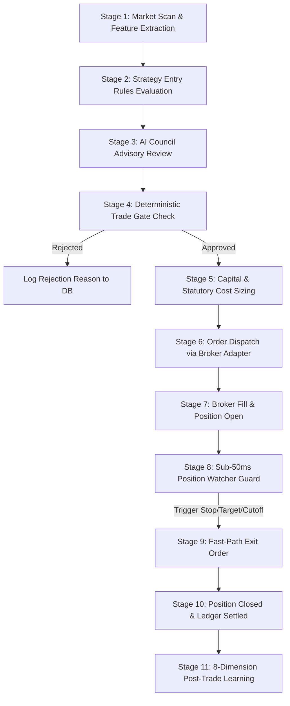

# Trade Lifecycle & Operational Workflow

This document details the step-by-step path every micro-trade follows, from initial market scanning through post-trade settlement and analytics.

---

## 1. Trade Lifecycle Stages

---

## 2. Detailed Stage Breakdown

### Stage 1: Market Scan & Feature Extraction
- The `MarketDataNormalizer` streams tick and candle data for liquid micro-cap instruments.
- Computes real-time indicators: 9/21 EMA cross, 14-period RSI, Average True Range (ATR), and Volume-Weighted Average Price (VWAP).
- Ensures monotonic timestamps and rejects spreads greater than 0.5%.

### Stage 2: Strategy Entry Rules Evaluation
- **Early Move Strategy**: Identifies volatility compression breakouts within the first 45 minutes of market open (09:15–10:00 IST).
- **Momentum Continuation Strategy**: Detects intraday trend pullbacks to key VWAP/EMA support with surging relative volume.
- The `CandidateRanker` scores and ranks signals based on risk-to-reward ratio, spread, and directional momentum.

### Stage 3: AI Council Advisory Review
- The top-ranked candidate is submitted to the local dual-LLM council:
  1. **Qwen3 Analyst**: Formulates an investment hypothesis, identifying primary catalysts and entry confidence (0.0 to 1.0).
  2. **DeepSeek-R1 Challenger**: Generates an adversarial counter-thesis, stress-testing against market traps, spread slippage, and liquidity risks.
  3. **Arbitration Engine**: Computes agreement score. If agreement score < 0.70, candidate is flagged for cautious review or vetoed.
- *Safety Guarantee*: AI Council cannot bypass deterministic risk rules or force order submission.

### Stage 4: Deterministic Trade Gate Check
The Trade Gate runs synchronous, non-blocking Python verification:
- [x] Maximum risk per trade <= 1.5% of total capital.
- [x] Daily cumulative drawdown <= 3.0% circuit breaker.
- [x] Current time < 15:00 IST (no new entries after 15:00).
- [x] System state is `ACTIVE` (kill switch not engaged).
- [x] Open position count < configured maximum (1 position max for micro-capital).

### Stage 5: Capital & Statutory Cost Sizing
- Evaluates total available buying power (₹100 baseline or ₹300 autonomous mode).
- Deducts estimated statutory friction (Brokerage, STT, Exchange fees, SEBI turnover, GST, Stamp duty).
- Calculates exact share quantity: `Quantity = floor(Trade_Risk_Amount / (Entry_Price - Stop_Loss_Price))`.

### Stage 6 & 7: Order Dispatch & Fill
- Submits order to `BrokerAdapter` (`PaperBrokerAdapter` or authenticated live broker).
- Awaits broker ACK and fill confirmation.
- State transitions: `PENDING_SUBMISSION` -> `SUBMITTED` -> `OPEN`.
- Position record committed to SQLite WAL database.

### Stage 8: Sub-50ms Position Watcher Guard
- Active position is immediately handed over to the isolated **Position Watcher** thread.
- Runs every tick with sub-50ms SLA:
  - **Hard Stop Loss**: Fixed price level calculated at entry.
  - **Dynamic Trailing Stop**: Activated when position achieves +1.5x risk.
  - **Profit Target**: Predefined target (e.g., 2.0x to 2.5x risk).
  - **15:15 IST Mandatory Square-Off**: Intraday equity liquidation.
  - **Stale Feed Exit**: Triggered if market feed drops for > 15 seconds.

### Stage 9 & 10: Exit Execution & Ledger Settlement
- When an exit trigger fires, Position Watcher routes an immediate market exit order to the broker.
- Upon fill ACK, position transitions `EXITING` -> `CLOSED`.
- Net realized P/L and actual statutory costs are calculated and persisted to `capital_snapshots` and `positions`.

### Stage 11: 8-Dimension Post-Trade Learning
- The trade is evaluated across 8 analytical dimensions:
  1. Thesis validity vs price action.
  2. Slippage vs modeled expectations.
  3. Holding time vs optimal exit.
  4. Commission & fee drag % of gross profit.
  5. Maximum Adverse Excursion (MAE).
  6. Maximum Favorable Excursion (MFE).
  7. Challenger critique accuracy.
  8. Execution latency profiles.
- Outputs versioned strategy parameter recommendations for operator review (zero auto-deployment).
